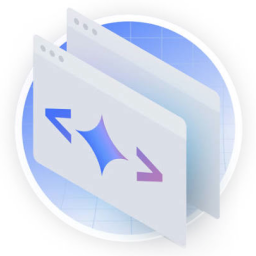

<p align="center"></p>

# CodeWiki

A native Windows app and a Rust backend that write and maintain a wiki for a codebase, for both people and coding agents.

The wiki is an Obsidian vault of Markdown notes at `<repo>/obsidian/`. It lives in the repository, so it is versioned with the code and readable without CodeWiki.

> Status: version 0.1.0, the first release. See `ROADMAP.md` for what is verified and what is not.

## What it does

- **Writes the wiki.** Parses the repository, builds a dependency graph, and writes notes for packages, modules, key types, startup flows, external integrations, patterns and operations, with Mermaid diagrams and illustrations.
- **Keeps it current.** After new commits it rewrites only the notes whose source changed.
- **Protects your edits.** A note you edited is never overwritten. Proposed changes wait in a review queue until you approve or reject them.
- **Answers agents.** An MCP server gives Claude Code and other agents the wiki, symbol detail, search, risk and impact analysis.
- **Analyses the code.** Hotspots, ownership, change coupling, blast radius, dead code, documentation drift, file health, test impact, coverage gaps, security patterns, refactoring suggestions, decision records and API contracts.

Symbols are extracted for Rust, Python, TypeScript, JavaScript and Java. Other files are indexed by path.

No LLM is required. Without one, notes are built from the code's structure. With one, the prose, the answers and the illustrations are written by the model and checked against the house style before they are saved.

## Parts

| Part | What it is |
|---|---|
| `codewiki` | Command line tool and backend server (HTTP API, no web pages) |
| `codewiki-app` | Desktop app for Windows 11, native Rust on GPUI |
| `codewiki-mcp` | Small stdio program that connects coding agents to the backend |

The app and the MCP program start a local backend when none is running, or connect to one in Docker or on another machine.

## Install

Requires Windows 11. Download `CodeWiki-<version>-windows-x64.zip` from the [latest release](https://github.com/Fly-onlyone/CodeWiki/releases/latest); the `.sha256` file beside it holds its checksum. Unpack it and double-click `install.cmd`. It copies the programs to `%LOCALAPPDATA%\Programs\CodeWiki`, adds that folder to your `PATH` and creates a Start Menu shortcut. `uninstall.cmd` in that folder reverses it; `uninstall.cmd -PurgeData` also deletes the index, the logs and the settings.

To build the same zip from source, with Rust 1.95 or newer and the MSVC toolchain:

```
pwsh scripts\package.ps1
```

It writes `dist\CodeWiki-<version>-windows-x64.zip`.

The `.cmd` files run `install.ps1` and `uninstall.ps1`, which Windows refuses to run directly unless scripts have been allowed. From a terminal, `powershell -ExecutionPolicy Bypass -File install.ps1` does the same.

### Updates

An installed app updates itself. Once a day, when it starts, it asks GitHub for the latest release; when there is a newer one, the toolbar and Home show "Update to <version>". One click downloads the zip, checks it against its `.sha256` file, replaces the programs and restarts the app on the same repository. Settings → Updates shows the version, checks on demand ("Check now") and turns the daily check off. Ctrl+K → "Check for updates" does the same.

The backend is stopped first and a new one starts with the new app. A coding agent's MCP bridge that is running keeps working and reaches the new backend on its next call; restarting the agent's session gives it the new bridge too. If anything goes wrong, the app says what and leaves the installation as it was. Pre-releases are never offered, and a copy that was only unpacked, or built from source, does not update itself.

## Use

In a repository:

```
codewiki init          # index the code and write the wiki
codewiki update        # after new commits
codewiki status
codewiki check         # findings for CI; --format sarif or junit
```

`codewiki --help` lists every command. Start `codewiki-app` with a repository folder as its first argument, or from inside one. It opens on Home: "Open folder…" and the projects opened before, the latest first; a project whose folder is not found stays listed, with a Remove button. Ctrl+K opens the command palette. Controls follow Material UI and move on springs; reports are pages of tiles, tables and cards. The Settings page changes the theme and turns animations down; by default the app follows the Windows animation setting.

Closing the app also stops the local backend it used; one named by `CODEWIKI_URL` is left running. The app and the backend it starts write their logs to `%LOCALAPPDATA%\CodeWiki\logs` (`app.log`, `backend.log`). Set `CODEWIKI_LOG=debug` for more.

### With an LLM

| Variable | Values |
|---|---|
| `CODEWIKI_LLM` | `anthropic`, `openai`, `ollama`, `claude-cli`, `codex-cli`, `none` |
| `CODEWIKI_MODEL` | Model name for the chosen provider |
| `ANTHROPIC_API_KEY`, `OPENAI_API_KEY`, `OPENAI_BASE_URL` | Credentials and endpoint for the API providers |

### Search

Search combines full-text matching with vectors. `CODEWIKI_EMBED` selects where vectors come from: `local` (default, built in, no model needed), `ollama`, `openai` or `none`. `CODEWIKI_EMBED_MODEL` names the model for the last two.

### Claude Code plugin

The plugin in `plugins/claude-code/` connects Claude Code to the wiki and the index, so that Claude reads what CodeWiki knows about the code before it explores the code by hand. It adds two things.

**An MCP server.** The plugin runs `codewiki-mcp`, which starts a local backend on first use, or uses the one at `CODEWIKI_URL`. It gives Claude 24 tools:

| Purpose | Tools |
|---|---|
| Orientation | `get_overview`, `get_architecture`, `get_workspace`, `list_repos` |
| Reading the code | `get_context`, `get_symbol`, `search_codebase`, `get_answer`, `read_note`, `get_dependency_path`, `get_why`, `list_decisions` |
| Before and after a change | `get_risk`, `get_change_risk`, `get_blast_radius`, `get_impacted_tests` |
| Code health | `get_hotspots`, `get_dead_code`, `get_health`, `get_coverage`, `get_security_findings`, `get_refactoring_plan`, `get_contracts` |
| Upkeep | `sync_wiki` |

`sync_wiki` follows the same rule as `codewiki update`: a note a person edited is never overwritten, and the change waits in the review queue.

**A session-start briefing.** When a session starts or resumes, and after `/clear` or compaction, a hook runs `codewiki hook session-start` and adds up to five lines to Claude's context: whether the repository has a wiki, whether the wiki is stale against `HEAD`, how many proposals wait for review, and which tools to call first. The hook only reads files and asks git for `HEAD`. It does not start the backend, and it cannot fail a session.

`plugins/claude-code/README.md` describes each tool and shows a sample briefing.

To install the plugin:

1. Install CodeWiki as described in [Install](#install). Then open a new terminal, so that `codewiki` and `codewiki-mcp` are on `PATH`.
2. Add this repository as a plugin marketplace:

   ```
   claude plugin marketplace add Fly-onlyone/CodeWiki
   ```

   To use a clone instead of GitHub, pass its folder: `claude plugin marketplace add C:\path\to\CodeWiki`.
3. Install the plugin:

   ```
   claude plugin install codewiki@codewiki
   ```

   It is installed for your user. With `--scope project` it is recorded in the repository's `.claude/settings.json` instead, which you can commit to share it.
4. In a repository that has no wiki yet, run `codewiki init`.
5. Start Claude Code in the repository, or run `/reload-plugins` in a session that is already open. `/mcp` lists the server as `plugin:codewiki:codewiki`.

To use a backend in Docker or on another machine, set `CODEWIKI_URL` and `CODEWIKI_TOKEN` in the environment Claude Code runs in (see [Docker](#docker)).

To update or remove the plugin:

```
claude plugin update codewiki@codewiki        # then restart Claude Code
claude plugin uninstall codewiki@codewiki
claude plugin marketplace remove codewiki
```

### Codex

Codex has no plugin. `plugins/codex/README.md` gives the MCP server and session-start hook configuration that does the same.

### Docker

```
docker build -t codewiki .
docker run --rm -p 127.0.0.1:7411:7411 -e CODEWIKI_TOKEN=<secret> -v codewiki-data:/data -v C:\path\to\repos:/repos codewiki
```

Each released version is also pushed as `ghcr.io/fly-onlyone/codewiki:<version>`. Point the app or the MCP program at it with `CODEWIKI_URL=http://127.0.0.1:7411` and the same `CODEWIKI_TOKEN`. Set `CODEWIKI_WEBHOOK_SECRET` to let a git host trigger updates through `POST /v1/hooks/git`.

## Develop

```
cargo fmt --all
cargo clippy --workspace --all-targets -- -D warnings
cargo test --workspace
cargo deny check
```

`pwsh scripts\clean.ps1` frees the disk space builds leave behind. `AGENTS.md` holds the project rules.

CI runs these four on every push and pull request. It also runs `codewiki check` on this repository and reports the findings to code scanning, and gitleaks scans new commits for secrets. Dependabot opens update pull requests weekly.

To release, set `version` in the root `Cargo.toml`, merge it, and push a matching tag:

```
git tag v0.2.0
git push origin v0.2.0
```

The tag publishes the Windows zip as a GitHub Release and pushes the Docker image. A tag that does not match the `Cargo.toml` version fails the release.

### Test a package in a clean Windows

`scripts\vm` installs the package into a Hyper-V guest, uses it by keyboard and mouse, uninstalls it and keeps screenshots and a recording. It needs Hyper-V with your account in the group "Hyper-V Administrators", a Windows 11 ISO, `oscdimg.exe` from the Windows ADK, `ffmpeg` for the recording, and about 20 GB of disk (40 GB with the graphics-card guest).

```
pwsh scripts\package.ps1
pwsh scripts\vm\provision.ps1 -Iso <windows.iso> -MemoryMb 2048    # once per image
pwsh scripts\vm\test-release.ps1
pwsh scripts\vm\provision-gpu.ps1          # once, optional: a guest that shares your graphics card
pwsh scripts\vm\test-release.ps1 -Gpu
```

Results go to `report\vm-test-<date>\`, which git ignores: a report stays on the machine that ran it. Read the screenshots: the script checks exit codes, files and processes, not what a page looks like.

## License

Apache-2.0. See `LICENSE` and `NOTICE`.
