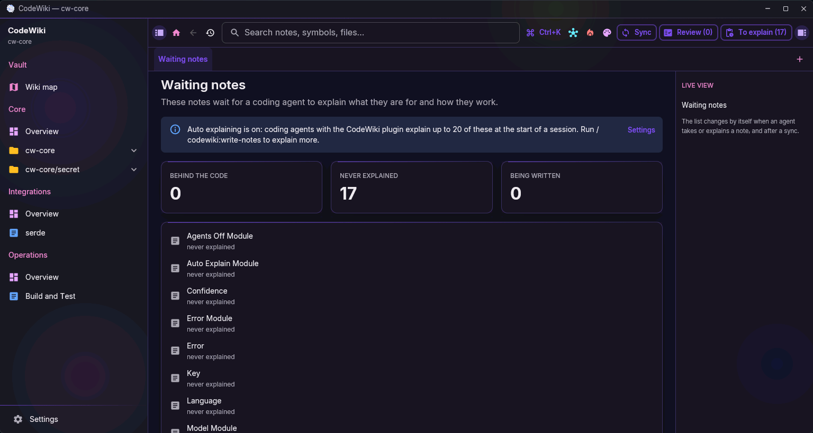
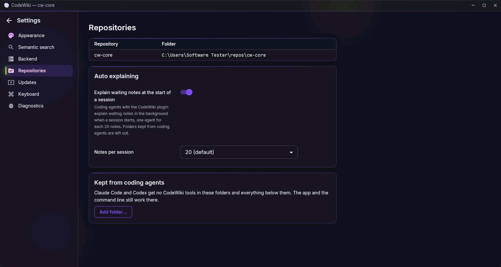
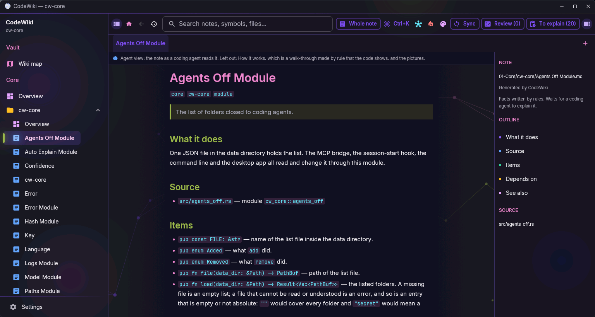

# Agent-written notes

CodeWiki calls no language model. Writing the wiki needs no API key and no online service.

Two writers write a note, and each has its own sections.

* **CodeWiki's rules** always run. They read your code and never guess. They cost nothing and give the same note on every run. They copy what your comments say, and they list which function calls which. They write the facts: where a thing is, its items, what it depends on and who uses it.
* **Your coding agent** writes the explanation: what a thing is for, how it works and what can go wrong. It does that through the plugin, with the [Claude Code plugin](claude-code-plugin.md) or the [Codex plugin](codex.md). It reads the note's source files, writes its sections and sends them. It never sends a whole note, so it cannot change a fact.

A wiki that no agent has explained is complete. It is as good as the comments in your code.

## Who writes which section

A note about a module, a package of your own or a type has these sections:

| Section                           | What it holds                                                        | Who writes it                                                              |
| --------------------------------- | -------------------------------------------------------------------- | -------------------------------------------------------------------------- |
| Summary, the line under the title | What the thing is for, in one sentence                               | Rules: the first sentence of its comment                                   |
| **What it does**                  | The purpose, and what a user of the program sees of it               | The agent. Until then, rules: the rest of the comment                      |
| **Source**                        | The file                                                             | Rules                                                                      |
| **How it works**                  | The path from a cause to its result, with conditions and error paths | The agent. Until then, rules: numbered steps of which function calls which |
| **Items**                         | Each function, type and constant, with its signature                 | Rules: the item's comment, or what the code says of it                     |
| **Depends on**, **Used by**       | The notes on either side                                             | Rules                                                                      |
| **Gotchas**                       | What a maintainer could get wrong                                    | The agent, or you                                                          |

Other kinds of note divide the same way. In an integration note the agent writes **What it does**, **Wire-up**, **Auth mode** and **Gotchas**. In a flow or operations note it writes **How it works** and **Gotchas**, under the diagram or the commands that rules write. In a pattern note it writes **Why** and **Don't**.

Three things to know when you read a note:

* **Calls are listed in the order of the source.** The steps that rules write under **How it works** name calls in the order they stand in the file. The rules do not see an `if` or a loop, so a step like "`set` calls `write`, then `remove`" can mean "one or the other". The agent's explanation says which. So does the code.
* **Not every call is found.** A call through a value whose type the index cannot tell, such as a trait object or a callback, is left out and never guessed.
* **A long list stops at 20 items** and says how many it leaves out.

To get better notes without an agent, write comments. A `//!` comment at the top of a Rust module, a docstring in Python, or a doc comment in TypeScript or Java says what the module is for. A `///` comment above a function says what it does. So does an XML summary comment in C#. The wiki copies both whole.

## Pictures

The agent may give a section a picture: a row of numbered boxes joined by arrows that shows what happens from a cause to its result, and marked key points or warnings. The app draws it inside the section it explains.

A picture is a short text kept beside the note, in a file named after the note with the ending `.openui`. The note's Markdown stays as it is, and Obsidian shows the note without the picture. A note has at most four pictures. A note that no agent explained has none.

## The notes that wait

A note waits when no agent has explained it, or when its explanation may be behind the code.

In the app, **To explain (N)** in the toolbar shows how many wait. It opens the **Waiting notes** page. The page shows three counts: **Behind the code**, **Never explained** and **Being written**. Below them it lists the notes, those behind the code first. A note that an agent holds says **an agent is writing it**. The list changes by itself when an agent takes or explains a note, and after a sync.



The details pane of a note says who explained it, or that it waits.


The count follows updates that the app's backend runs. A run on the command line, or an edit in Obsidian, shows after the next change or after you reopen the repository.


## Explain notes yourself

In Claude Code with the plugin, run `/codewiki:write-notes`:

```
/codewiki:write-notes                      the first 5 notes that wait
/codewiki:write-notes waiting 12           the first 12
/codewiki:write-notes waiting all          every note that waits, 20 at a time
/codewiki:write-notes 01-Core/cw-parse/    the waiting notes of one folder
/codewiki:write-notes "Scan Module"        one note
/codewiki:write-notes changed              the notes about the files you changed
```

For each note, Claude reads its source files, writes the sections that are its own and sends them with `submit_note`. Codex does the same with its `write-notes` skill.

Writing notes uses your Claude usage allowance. A note is a few file reads and one or two tool calls. A first pass over a large repository is several hundred notes, so write a folder at a time.

After a code change of its own, Claude writes the notes about the files it changed, at most three, without being asked.

## Auto explaining

Auto explaining makes a coding agent explain the waiting notes without being asked. It is on by default.

When a session starts fresh (startup, resume or `/clear`), the briefing tells the agent to explain the waiting notes by itself:

* **Claude Code** starts the `codewiki:note-writer` agent in the background, on Sonnet, when you send your first message. It tells you in one line.
* **Codex** uses its `write-notes` skill after your first request.

It writes 20 notes per session by default, stale ones first, so it uses your allowance. **Notes per session** sets 5, 10, 20, 50, 100 or Unlimited. One note-writer writes at most 20, so Claude Code starts one for each 20 notes, all at once. Codex lists 20 at a time until it has written them all.

Several sessions at once get different notes: a listed note is lent to one agent for 30 minutes.

Auto explaining does not run:

* in a session in a linked git worktree;
* in a [folder kept from coding agents](keep-agents-out.md);
* in plan mode.

To turn it off or to change the count, use Settings → Repositories → **Auto explaining**.



## What CodeWiki checks

CodeWiki refuses a submission, and names every fault, when:

* a section is not one of the agent's;
* a section holds a `#` or `##` heading, or more than 300 words;
* a section links to a note that does not exist, or breaks the house style;
* a picture uses a component that does not exist, or is too large;
* the note, or its code, changed since the agent read it.

The agent then fixes the faults and sends again.

## What a coding agent reads

The MCP tool `read_note` gives an agent a note without its pictures. While **How it works** is only the list of calls that rules write, it is left out too, because the agent reads the calls in the code it is about to edit. Once an agent explained that section, it is always included. `read_note` with `full: true` gives the whole text.

In the app, **Agent view** in a note's toolbar shows the same. A line above the note says what is left out, and the button then reads **Whole note**.



## Your edits

A note you change by hand is yours from then on. Neither CodeWiki nor an agent writes over it. When its code changes, the new text waits as a proposal that you approve or reject. What an agent writes for it waits the same way, with its pictures. See [Review](../the-app/review.md).

After a CodeWiki update that changes how notes are written, the facts of every note you did not edit are written again. Explanations stay.

## When the code changes

`codewiki update` writes the facts of an explained note anew and keeps the agent's sections and pictures. The explanation was written from the files as they were, so the note is marked: its explanation may be behind. The app says so in the note's details, and such notes come first when an agent asks what waits. `/codewiki:write-notes changed` writes the notes about the files that changed.
