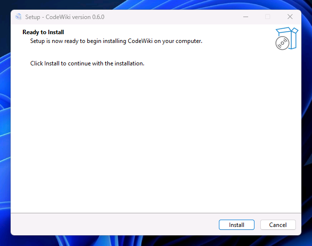

# Install

CodeWiki runs on Windows 11, 64-bit. It needs nothing else: no runtime to install first, no git, no account. The installer asks for no administrator rights.

## With the setup program



### Download the setup program

Open the [latest release](https://github.com/Fly-onlyone/CodeWiki/releases/latest) and download `CodeWiki-<version>-windows-x64-setup.exe`.



### Run it

Double-click the file. Windows SmartScreen may show **Windows protected your PC**. Click **More info**, then **Run anyway**.


The programs are not signed yet, so SmartScreen warns about them. This is expected.




### Follow the wizard

The wizard shows three pages: **Ready to Install**, **Preparing** and **Completing**. It does not ask for a folder. It installs to `%LOCALAPPDATA%\Programs\CodeWiki`.



It copies the programs and the plugins there, adds that folder to your user `PATH`, puts **CodeWiki** in the Start menu, and adds an entry **CodeWiki** to Settings → Apps. If something fails, it says why.



### Start CodeWiki

**Start CodeWiki** is checked on the last page. Leave it checked to open the app. Later, open the Start menu, type **CodeWiki** and press Enter. The app opens on [Home](../the-app/home.md).

The app that the last page starts has the `PATH` from before the install. Open a **new** terminal before you use the command line or start a coding agent:

```
codewiki --version
```



## With the zip instead

The zip does the same, except that it makes no entry in Settings → Apps.



### Download the zip

On the same release page, download `CodeWiki-<version>-windows-x64.zip`.

The file `CodeWiki-<version>-windows-x64.zip.sha256` beside it holds the zip's checksum. To check your download, run this in PowerShell and compare the result with the text in that file:

```powershell
(Get-FileHash -Algorithm SHA256 .\CodeWiki-<version>-windows-x64.zip).Hash.ToLower()
```



### Unpack it and run `install.cmd`

Right-click the zip, choose **Extract All**, open the folder you get and double-click `install.cmd`.

It installs to the same folder, adds it to your `PATH` and puts **CodeWiki** in the Start menu.



You can run the setup program over an installation made from the zip.

## What gets installed

| Program            | What it is                                                                   |
| ------------------ | ---------------------------------------------------------------------------- |
| `codewiki-app.exe` | The desktop app.                                                             |
| `codewiki.exe`     | The command line tool. It also runs the backend that the app and agents use. |
| `codewiki-mcp.exe` | The bridge between a coding agent and the backend.                           |

The `plugins` folder holds the plugins for [Claude Code](../agents/claude-code-plugin.md) and [Codex](../agents/codex.md). The license files are there too.

## Where CodeWiki keeps things

| What                                                               | Where                              |
| ------------------------------------------------------------------ | ---------------------------------- |
| The programs and the plugins                                       | `%LOCALAPPDATA%\Programs\CodeWiki` |
| The index, the logs and the list of repositories                   | `%LOCALAPPDATA%\CodeWiki`          |
| Your settings (theme, animations, zoom, recent projects and so on) | `%APPDATA%\CodeWiki`               |
| The wiki itself                                                    | `obsidian\` inside each repository |

The wiki lives in your repository, as plain Markdown. You can commit it, read it on GitHub, and open it in Obsidian. The index is only a cache: CodeWiki can rebuild it from the repository at any time.

## Uninstall



Open Settings → Apps and uninstall **CodeWiki**. A running CodeWiki is closed for you.

The uninstaller asks whether to delete your data (`%LOCALAPPDATA%\CodeWiki`: the search index, the logs and the list of repositories) and your settings (`%APPDATA%\CodeWiki`) as well. It keeps them unless you answer **Yes**. The wiki notes in your repositories stay either way.

A silent uninstall (`/VERYSILENT`) keeps them too, unless you add `/PURGEDATA`.

If another program uses a file in the install folder, the uninstall stops and keeps the entry. Close that program and uninstall again. A terminal whose current folder is the install folder leaves the empty folder behind. Delete it afterwards.



Open `%LOCALAPPDATA%\Programs\CodeWiki` and double-click `uninstall.cmd`. Use it only for an installation made from the zip. It stops CodeWiki if it is running, and removes the programs, the `PATH` entry and the Start menu shortcut.

Your index, logs and settings stay. To delete them too, run this from a terminal in that folder:

```
uninstall.cmd -PurgeData
```



Both ways also remove the **Start with Windows** entry, if you turned it on. The wikis in your repositories are never touched.
