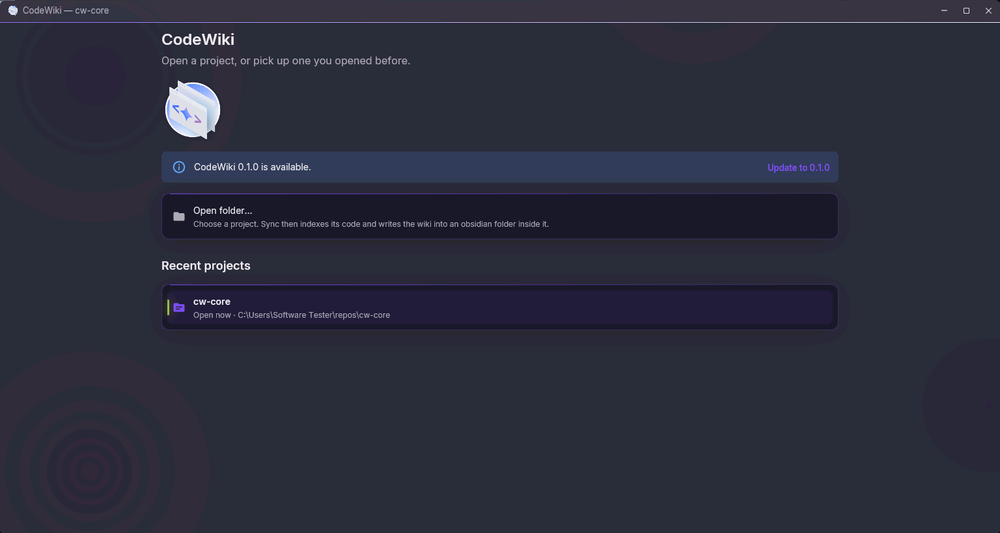

# Updating

An installed CodeWiki updates itself. This holds for an installation made by the setup program and for one made by `install.cmd` from the zip.

## Install an update

Once a day, while it runs, the app asks GitHub whether a newer version has been released. When there is one, the app offers it in five places:

* on **Home**, as a notice with an **Update to \<version>** button;
* in the toolbar, as an **Update to \<version>** button;
* in the tray menu, as **Update available: \<version>**;
* in the command palette (Ctrl+K), as **Update CodeWiki to \<version> and restart**;
* in Settings → Updates, where the button reads **Install and restart**.

Press any of them. The app then:

1. downloads the package and checks it against the checksum published with the release;
2. stops the backend;
3. replaces the programs;
4. starts again on the project you had open.

This takes a few seconds. If anything goes wrong, the app says what, and leaves the installation as it was. After an update from the setup program, the version in the Settings → Apps entry is updated too.


A coding agent that is using CodeWiki keeps working through an update. Its next call reaches the new backend. Restart the agent's session to give it the new bridge program as well.


## Check now, or turn the check off

Open Settings → Updates (Ctrl+K, then **Open settings**). The **Version** line shows your version and what the last check found.

* **Check now** asks GitHub at once. The palette command **Check for updates** and the tray menu row **Check for updates** do the same.
* When an update waits, the button reads **Install and restart**.
* **Daily check** says whether the app checks by itself. Switch it off to stop the daily check. The app then looks only when you press **Check now**.

## What is never installed

* **Pre-releases.** Only full releases are offered.
* **Anything from elsewhere.** The app accepts a package only from the CodeWiki repository's releases on GitHub, over a secure connection.

## Copies that do not update themselves

A copy that you only unpacked, or built from source, does not update itself. Settings → Updates shows its version as a development build, and has no **Daily check** switch. To update such a copy, download the new package and run `install.cmd`, or run the setup program.

To update by hand at any time, do the same: run the setup program, or unpack the new zip and run its `install.cmd`.
