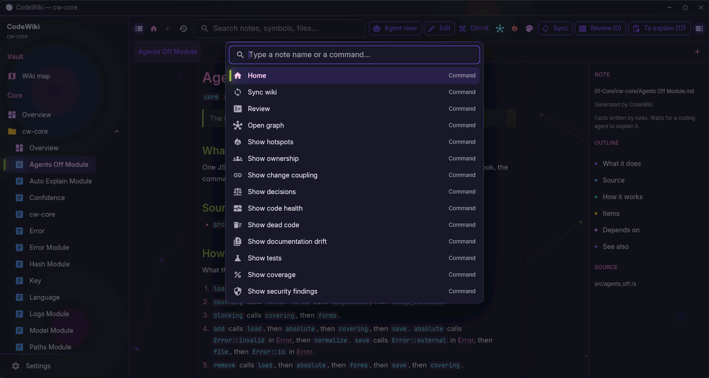

# Command palette and shortcuts

Press **Ctrl+K** anywhere in the app. The palette opens over the page. This also holds on Home, right after the app starts, also on a first start with no project yet.

Type a few letters of what you want. The list narrows as you type, and shows up to 14 rows. Use the arrow keys to move, **Enter** to run the entry, and **Esc** to close the palette. A search for what you typed is always the last row, so Enter does something even when nothing matches.

## What you can type

| Type                             | To                                                                                                |
| -------------------------------- | ------------------------------------------------------------------------------------------------- |
| A note's name                    | Open that note. The map is **Wiki map**; a folder's index is **\<Folder> overview**.              |
| `Switch to` and a project's name | Switch to that project. Listed when more than one project is registered.                          |
| `Theme:` and a theme's name      | Apply that theme.                                                                                 |
| `home`                           | Go to Home.                                                                                       |
| `sync`                           | **Sync wiki**: bring the wiki up to date.                                                         |
| `review`                         | Open the [Review](review.md) page.                                                                |
| `graph`                          | **Open graph**.                                                                                   |
| `show`                           | The reports, one by one: see below.                                                               |
| `theme`                          | **Choose theme** opens the theme menu.                                                            |
| `settings`                       | **Open settings**, and **Settings: \<category>** for each of the seven categories.                |
| `tab`                            | **New tab** and **Close tab**. Not listed when tabs are off.                                      |
| `sidebar`, `details`             | **Toggle sidebar** and **Toggle details pane**.                                                   |
| `zoom`                           | **Zoom in**, **Zoom out** and **Reset zoom**.                                                     |
| `open folder`                    | **Open folder…**: open another project.                                                           |
| `update`                         | **Check for updates**. When one waits, **Update CodeWiki to \<version> and restart** comes first. |
| `animations`                     | **Animations: follow Windows**, **reduced** or **full**.                                          |
| `logs`                           | **Open logs folder**.                                                                             |
| `quit`                           | **Quit CodeWiki**. See [Tray and closing](tray.md).                                               |

The reports are **Show hotspots**, **Show ownership**, **Show change coupling**, **Show decisions**, **Show code health**, **Show dead code**, **Show documentation drift**, **Show tests**, **Show coverage**, **Show security findings**, **Show refactoring plan**, **Show workspace**, **Show API contracts** and **Show waiting notes**.

Some entries appear only when they apply:

* **Reconnect to the backend** while the backend does not answer.
* **Start with Windows: turn on** or **turn off**, in an installed copy only.
* **Keep agents out of this project** or **Let agents into this project**, for the open project. Neither is listed when a folder above or inside the project is on the list. Change it in Settings then.

## Keyboard shortcuts

| Keys       | Action                        |
| ---------- | ----------------------------- |
| Ctrl+K     | Command palette               |
| Ctrl+,     | Settings                      |
| Ctrl+T     | New tab                       |
| Ctrl+W     | Close tab                     |
| Ctrl+Tab   | Next tab                      |
| Alt+Left   | Back                          |
| Ctrl+B     | Hide or show the sidebar      |
| Ctrl+Alt+B | Hide or show the details pane |
| Ctrl+S     | Save the note being edited    |
| Ctrl+=     | Zoom in                       |
| Ctrl+-     | Zoom out                      |
| Ctrl+0     | Back to 100%                  |
| Ctrl+wheel | Zoom in or out                |

Esc closes the palette, a menu, or the diagram viewer. The same list is in Settings → Keyboard.

## Without a mouse

Every control can be reached from the keyboard.

| Keys           | Action                                                                                                                               |
| -------------- | ------------------------------------------------------------------------------------------------------------------------------------ |
| Tab            | Move the focus to the next control: the sidebar first, then the toolbar and the page. The control that has the focus is highlighted. |
| Shift+Tab      | Move the focus back.                                                                                                                 |
| Enter or Space | Press the control that has the focus.                                                                                                |
