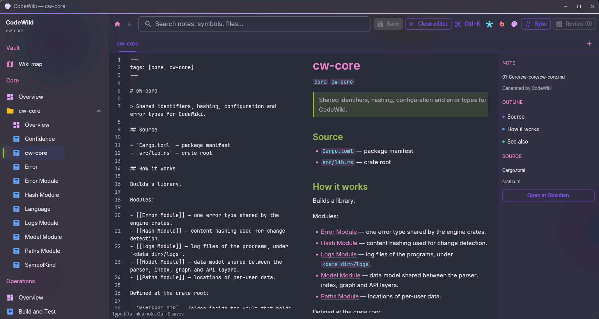

# Editing and proposals

The wiki is yours to edit. CodeWiki writes the facts of every note, and a coding agent can explain it. Once you change a note, neither CodeWiki nor an agent overwrites it. They ask you instead.

## Edit a note

1. Open the note and press **Edit** in the toolbar.
2. Change the Markdown on the left. The right side shows the result as you type.
3. Press **Save**, or Ctrl+S.



Type `[[` to link to another note; the editor offers the names.

**Discard** drops your changes and closes the editor. When you have made none, the button reads **Close editor**. While a note has unsaved changes, the app keeps you on it: it does not leave the page, and it does not quit, until you save or discard. It says **Save or discard your edits first.**

You can also edit the files directly, in Obsidian or any editor. They are plain Markdown in the project's `obsidian` folder.

## What happens to an edited note

When the code behind a note changes, an update wants to rewrite the note.

* **A note nobody edited** is rewritten.
* **A note you edited** is left as it is. The text CodeWiki would have written becomes a **proposal**.

This rule holds everywhere: for **Sync** in the app, for `codewiki update` in a terminal, and for a coding agent's `sync_wiki` tool.

## Two kinds of proposal

A proposal waits on the [Review](review.md) page until you approve or reject it. The page names the kind of each one.

| Kind       | Where it comes from                                                                                                                         |
| ---------- | ------------------------------------------------------------------------------------------------------------------------------------------- |
| **Sync**   | An update. The note's code changed, and this is the text CodeWiki would have written.                                                       |
| **Agent**  | A coding agent. It explained a note that you edited, and sent its text and pictures. See [Agent-written notes](../agents/writing-notes.md). |
| **Retire** | A sync. It lists notes you wrote yourself about code that is gone. See below.                                                               |

A sync proposal and an agent proposal for the same note do not replace each other. Only one of them can be written: when you approve one, the other is superseded.

After you approve an agent's proposal, the note is still yours. An update still sends you a proposal for it, not a rewrite.

From a terminal:

```
codewiki proposals
codewiki approve <id>
codewiki reject <id>
```

The command line decides one proposal at a time. Deciding several at once is in the app only.


A coding agent's session-start briefing says how many proposals wait, so the agent can remind you.


## When the code is gone

A note describes something in the code. When that is deleted, the note describes nothing, and CodeWiki takes it out of the wiki without losing anything you or an agent wrote.

* **A note nobody wrote in** is deleted with its code.
* **A note with an agent's explanation or your edits** follows its code when the code only moved. The note moves with it, keeps what was written, and waits for an agent to look again. When it is not clear what moved where, nothing is carried over, and the sync says so.
* **When the code is gone**, such a note is deleted only after the deletion is committed, and only if git holds the note as it is now. So git can always bring it back. Until then the note stays. The details pane says **What it describes is gone from the repository**, and the note counts as no note of the wiki.
* **A note you wrote yourself** is about the files it names in backticks, anywhere in its text. When none of them exists any more, CodeWiki never deletes it by itself. All such notes wait in one proposal, **Notes about code that is gone**, on the Review page. Untick the notes you want to keep, then approve. The others are deleted. A note you keep, or all of them if you reject, stays as history and is not proposed again.
* **A note that still names a file that exists**, or names no file at all, is left alone. When a file a note names was only moved, the path in the note is updated.

Links to a deleted note become plain words in the notes that stay. A picture only deleted notes showed goes with them.

Without git, nothing that holds written work is ever deleted.

The page **Sync complete** lists what became of such notes under **Notes of code that is gone or moved**.

## Keep decisions

A decision record says why something is the way it is. Create one with:

```
codewiki decisions --new "Use SQLite for the index"
```

CodeWiki links a decision to the code it cites and tells you when that code has changed since. `codewiki why <file or symbol>` gathers the decisions, the recorded reasons and the latest commits for one place in the code.
