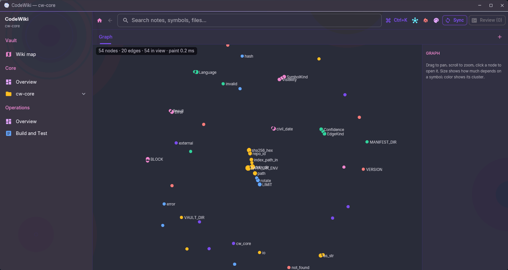

# Graph

The graph draws the project's symbols as dots and their dependencies as lines. Symbols that belong together share a color, and a symbol that much depends on is drawn larger.

## Open it

Press the **Graph** button in the toolbar, or press Ctrl+K and choose **Open graph**.

## Move around

| To             | Do this                                              |
| -------------- | ---------------------------------------------------- |
| Move the view  | Drag with the left mouse button.                     |
| Zoom in or out | Turn the mouse wheel. The view zooms at the pointer. |
| See more names | Zoom in. Names appear as there is room for them.     |
| Open a symbol  | Click its dot. Its symbol page opens.                |

## Read it

* A tight cluster of one color is a group of symbols that mostly use each other: usually a module or a feature.
* A large dot with many lines is a symbol much of the code leans on. A change there reaches far. Its file page tells you how far.
* A dot with no lines may be unused. The **dead code** report lists the candidates.

The graph shows symbols. Source in a language that CodeWiki maps only at file level has none. See [Languages](../reference/languages.md).
