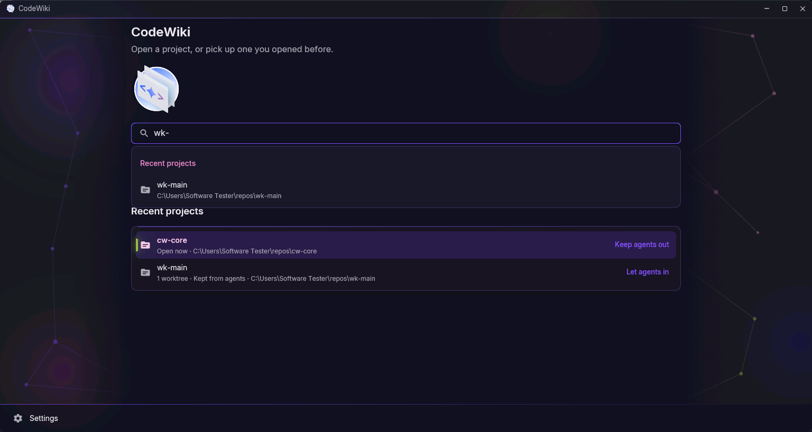
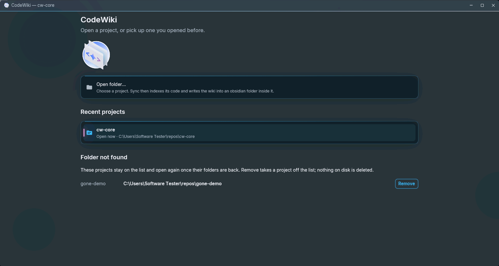

# Home

CodeWiki starts on Home. It fills the window: the sidebar, the toolbar and the tabs appear once you open a project's page.



## Open a project

* **Open folder…** asks Windows for a folder and opens it as a project. A new project has no wiki yet; Home then shows a notice with a **Sync** button that writes it.
* **Recent projects** lists every project CodeWiki knows, the one you opened last first. The project that is open now is marked **Open now**. Click a project to open its Wiki map.
* **Settings** at the foot of Home opens [Settings](settings.md).

To come back to Home, press the **Home** button at the left of the toolbar, or press Ctrl+K and choose **Home**. **Back** (Alt+Left) also returns here from a project you opened from Home.

The keyboard shortcuts work on Home from the moment the app starts, also on a first start with no project yet. See [Command palette and shortcuts](command-palette-and-shortcuts.md).

## Find a project you opened before

Once you have opened a project in the app, a search field sits above **Open folder…**. It has the focus when Home opens.

Type a few letters. Home suggests up to eight projects you opened before:

* first the projects whose name holds what you typed;
* then the projects with a folder name, or a word in one, that starts with it.

If you type a `\` or a `/`, the text is matched anywhere in the folder path. Move through the suggestions with Up and Down and press Enter to open one. Enter with none chosen opens the first. Esc empties the field and closes the list. A linked git worktree is not suggested.

The toolbar has a shortcut too: the **Open recent** button, after **Back**, lists up to eight projects you opened before, without the open one, and **Open folder…**.

## What a project's row says

A project's row starts with marks, then the folder.

| Mark                                      | Meaning                                                                                              |
| ----------------------------------------- | ---------------------------------------------------------------------------------------------------- |
| **Open now**                              | This is the project that is open.                                                                    |
| **1 worktree**, **\<n> worktrees**        | The repository has linked git worktrees. They have no row of their own. See below.                   |
| **Worktree of \<name>**                   | The open folder is a linked git worktree of that project.                                            |
| **Kept from agents**                      | Coding agents get no CodeWiki tools in this folder. The button at the right reads **Let agents in**. |
| **Kept from agents by \<folder>**         | A folder above it is kept from agents. The button reads **Settings…**.                               |
| **Kept from agents (contains \<folder>)** | A folder inside it is kept from agents. The button reads **Settings…**.                              |

The button **Keep agents out** appears on a project that is not kept. See [Folders kept from coding agents](../agents/keep-agents-out.md).

### Git worktrees

A linked git worktree is another copy of a repository. A coding agent often makes one for a task. CodeWiki answers the agent there like in any folder, but the worktree is not a project on Home. The row of its repository says how many worktrees it has. While you have a worktree open, Home lists it, with the repository it belongs to. When a worktree's folder is removed, CodeWiki forgets it and deletes its index.

A wiki that you sync in a worktree is the repository's wiki. Its notes name the repository, not the worktree's folder.

## When a project's folder is not found

A project whose folder was moved, renamed or deleted, or whose drive is not connected, is listed apart under **Folder not found**.



CodeWiki does not forget such a project by itself. It opens again as soon as its folder is back in place. **Remove** takes it off the list; nothing on disk is deleted, and opening the folder again later adds it back.

## When an update waits

When a newer version of CodeWiki has been released, Home shows a notice with an **Update to \<version>** button. See [Updating](../getting-started/updating.md).

## When the backend is not reachable

The app shows a page about it instead. See [Notifications and reconnecting](notifications.md).

## Start the app on a project

From a terminal, pass the project's folder:

```
codewiki-app C:\path\to\project
```

The app opens on Home and marks that project. If you switch on Settings → Appearance → **Open the last repository**, the app starts on the wiki map of the repository it opened last, not on Home. A project with no wiki yet still starts on Home.

Starting CodeWiki while it runs opens the window of the running app, on the folder you named if you named one. See [Tray and closing](tray.md).
