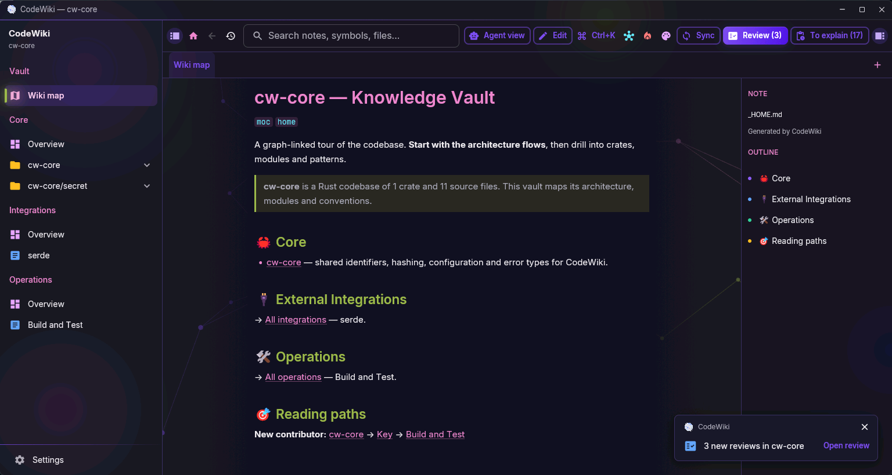
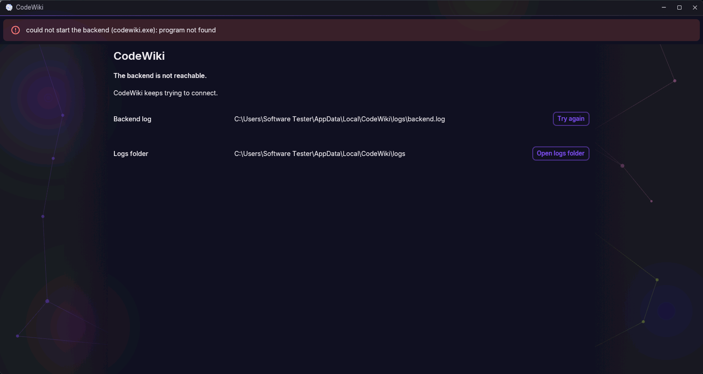
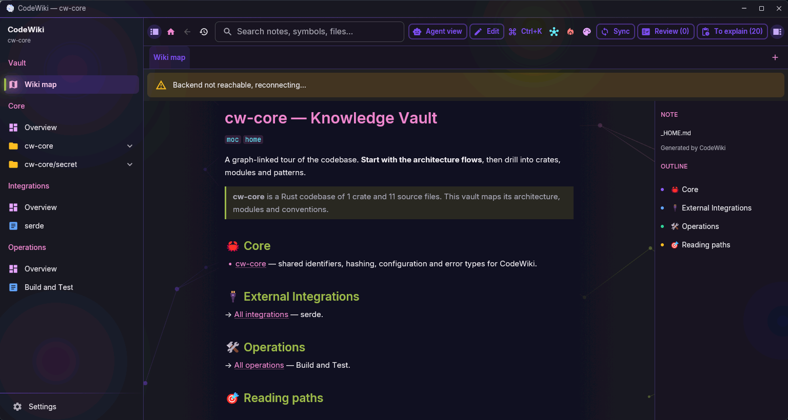

# Notifications and reconnecting

## Notices

When something happens that you may want to know, CodeWiki tells you.

* **While the window is on screen**, a small notice appears at the bottom right. It shows the app's logo and name, a close button, and a line with an icon, a title and, sometimes, a button. At most three show at once, and each stays about six seconds. A newer notice about the same thing replaces the older one.
* **While the window is hidden or minimized**, a Windows notification takes its place.

### What it tells you

| Notice                                                       | When                                                                                                                       |
| ------------------------------------------------------------ | -------------------------------------------------------------------------------------------------------------------------- |
| **Connected**                                                | The app reached its backend at start.                                                                                      |
| **Reconnected**                                              | The app reached its backend again after it stopped answering.                                                              |
| **\<n> new reviews in \<project>** (or **1 new review**)     | New proposals wait. The button **Open review** opens the [Review](review.md) page.                                         |
| **Connected to \<server>**                                   | An embedding server that was not running has come up. See [Set up semantic search](../getting-started/semantic-search.md). |
| **Written to \<note>**, **Approved \<n>**, **Rejected \<n>** | You decided proposals. See [Review](review.md).                                                                            |
| **CodeWiki is still running**                                | The first time you close the window. See [Tray and closing](tray.md). Windows shows this one.                              |

The notice about new reviews counts per project. Your own sync does not raise it. Notices that come while the first is still showing add up. Windows gets at most one such notification a minute for each project.

## When the backend does not answer

The app gets everything from its backend, `codewiki.exe`. It starts one itself when none is running.

### At start

If the app cannot reach a backend, it shows a page **The backend is not reachable.** It says **CodeWiki keeps trying to connect.** The page has:

* **Backend log**, with the path of the log and a **Try again** button;
* **Logs folder**, with an **Open logs folder** button.

When the app reaches the backend, the **Connected** notice shows and the page you wanted opens.

If the backend that does not answer is one that you saved in Settings → Backend, the page also says so, and has **Use local backend** and **Open settings**. The app never goes back to a backend on this machine by itself, because that one could show other wikis, or none.

### During a session

When the backend stops answering, a banner appears above the page: **Backend not reachable, reconnecting…** The app counts a loss after two missed status checks in a row.

* **A local backend:** the app tries to start a new one, then looks for it again.
* **A backend on another machine, from `CODEWIKI_URL` or Settings:** the app only looks for it. It never starts a backend in its place.

The waits between tries grow: 5, 10, 20 and then 30 seconds. A sign of life from the backend makes the next try due at once.

To try now, press Ctrl+K and choose **Reconnect to the backend**. When the backend is back, the banner goes, the notice **Reconnected** shows, and the open project reloads. If the new backend does not know that project, the app goes to Home.

While an update installs, the app starts no new try.

### The embedding server

If the embedding server that you chose is not running, Settings → Semantic search shows a warning and asks the server again by itself. When it answers, the notice **Connected to \<server>** shows. You do not have to restart anything.
