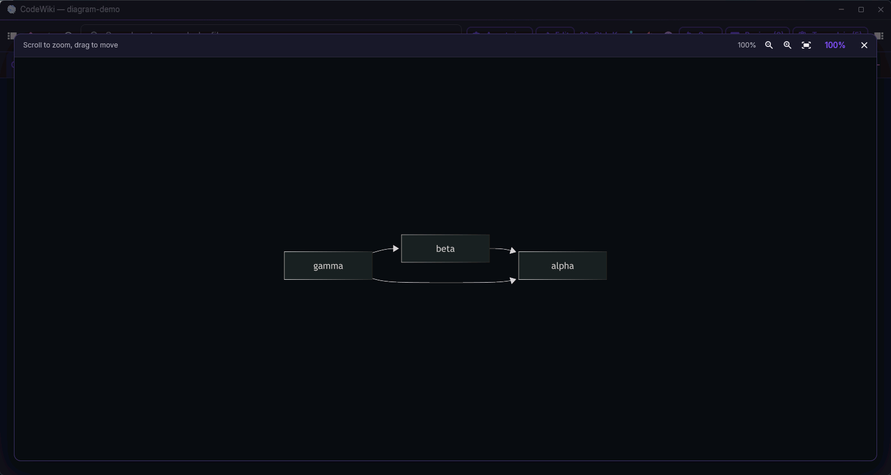

# Reading notes

Open a project from [Home](home.md) and you land on its **Wiki map**.

.png>)

## The parts of the window

| Part                | What it does                                                                                                                                                                                     |
| ------------------- | ------------------------------------------------------------------------------------------------------------------------------------------------------------------------------------------------ |
| **Sidebar** (left)  | Lists the wiki by section: the map, the architecture notes, then a folder for each package. Click a folder to open it, a note to read it. **Settings** is at its foot. Ctrl+B hides or shows it. |
| **Toolbar** (top)   | Home, Back, the search box, and the buttons described below.                                                                                                                                     |
| **Tabs**            | Each tab holds a page. See [Tabs](reading-notes.md#tabs).                                                                                                                                        |
| **The note**        | The page you are reading. Links inside it lead to other notes, to symbols and to files. Click a diagram to enlarge it.                                                                           |
| **Details** (right) | The note's path and state, who explained it, its outline, and the source files it describes. Ctrl+Alt+B hides or shows it.                                                                       |

## The toolbar

| Button             | What it does                                                                                                                                                     |
| ------------------ | ---------------------------------------------------------------------------------------------------------------------------------------------------------------- |
| **Sidebar**        | Hides or shows the sidebar (Ctrl+B).                                                                                                                             |
| **Home**           | Goes to [Home](home.md).                                                                                                                                         |
| **Back**           | Goes to the page before this one (Alt+Left).                                                                                                                     |
| **Open recent**    | Lists up to eight projects you opened before, and **Open folder…**.                                                                                              |
| **Search**         | Searches notes, symbols and files. See [Search](reading-notes.md#search).                                                                                        |
| **Agent view**     | Shows the note as a coding agent reads it. The button then reads **Whole note**. See [Agent view](reading-notes.md#agent-view).                                  |
| **Edit**           | Opens the note in the editor. See [Editing and proposals](editing-and-proposals.md).                                                                             |
| **Ctrl+K**         | Opens the [command palette](command-palette-and-shortcuts.md).                                                                                                   |
| **Graph**          | Opens the [dependency graph](graph.md).                                                                                                                          |
| **Hotspots**       | Lists the files that are both large and often changed.                                                                                                           |
| **Theme**          | Opens the [theme menu](themes.md).                                                                                                                               |
| **Sync**           | Brings the wiki up to date with the code.                                                                                                                        |
| **Review (n)**     | Opens the [Review](review.md) page. The number says how many proposals wait for you.                                                                             |
| **To explain (n)** | Opens the Waiting notes page: the notes that wait for a coding agent to explain them. See [Agent-written notes](../agents/writing-notes.md). Off when none wait. |
| **Details**        | Hides or shows the details pane (Ctrl+Alt+B).                                                                                                                    |

While you edit a note, **Save** and **Discard** take the place of **Edit**. When an update waits, **Update to \<version>** appears too.

In a narrow window, some buttons shrink to icons or to their count, and the **Graph** and **Hotspots** buttons are hidden. The command palette still reaches them.

## Search

Type in the search box. After a short pause, a list under the box suggests up to ten notes, symbols and files that match.

* **Down** and **Up** move through the list. Up from the first row returns to the box.
* **Enter** opens the highlighted hit.
* **Enter** with no hit highlighted opens a Search page that lists every hit.

## Tabs

Each tab holds a page and its own history. **+** opens a new tab (Ctrl+T). The cross on a tab closes it (Ctrl+W). It shows when more than one tab is open. Ctrl+Tab moves to the next tab.



* Ctrl+click a note, or middle-click it.
* Right-click a note in the sidebar and choose **Open in new tab**.



* Middle-click a tab to close it.
* Right-click a tab and choose **Close**, **Close others**, **Close to the right**, **Close to the left** or **Close all**. The menu offers only what makes sense for that tab.



Right-click a tab and choose **Reveal in sidebar** to show its note in the sidebar, or **Copy note path** to copy the note's path.



To turn tabs off, or to open every note in a tab of its own, use Settings → Appearance → **Tabs**. With tabs off, one view holds every note. With **Open notes in a new tab** on, a note that is already open switches to its tab.

## Zoom

The whole window except its title bar can be made larger or smaller. The levels are 50, 67, 75, 80, 90, 100, 110, 125, 150, 175 and 200 percent. 100 percent is the default.

* Ctrl+wheel, Ctrl+= and Ctrl+- zoom in and out.
* Ctrl+0 goes back to 100 percent.
* Settings → Appearance → **Zoom** sets a level. The palette has **Zoom in**, **Zoom out** and **Reset zoom**.

## The details pane

The pane at the right shows the note's path and state, then who explained it, then its outline and its source files.

### A note's state

| State                                             | Meaning                                                                                                               |
| ------------------------------------------------- | --------------------------------------------------------------------------------------------------------------------- |
| **Generated by CodeWiki**                         | Nobody has edited it. An update may rewrite it.                                                                       |
| **Edited by hand — protected**                    | You changed it. An update leaves it alone and sends you a proposal instead.                                           |
| **Source changed — sync to refresh**              | The code behind it changed since it was written. Press **Sync**.                                                      |
| **What it describes is gone from the repository** | The code the note describes was deleted. See [Editing and proposals](editing-and-proposals.md#when-the-code-is-gone). |

Below the state, a line says who explained the note. It reads **Explained by \<agent>**, or says that the facts are written and the note waits for a coding agent. When the code moved on since, the pane says the explanation may be behind and why.

### The outline

The outline lists the note's sections. Click an entry and the note glides to that heading. The entry of the section you are reading is lit.

## Follow the code

A note about a module links to its symbols and files. A symbol page shows the definition, what the symbol uses and what uses it. A file page shows its risk, who owns it, what usually changes with it and what a change to it can reach.

## Diagrams

A diagram in a note can be too small to read in the page. Click it to open it over the window. There, the wheel zooms and a drag moves the diagram.

| Key or button    | What it does                       |
| ---------------- | ---------------------------------- |
| `+` and `-`      | Zoom in and out.                   |
| `0`              | Fit the diagram to the window.     |
| `1`              | Show it at its actual size (100%). |
| Esc or the cross | Close the viewer.                  |

## Pictures and the agent view

A coding agent can add pictures to the notes it explains: boxes joined by arrows, and marked key points. The app draws each picture inside the section it explains. Obsidian and GitHub show the note without it.

### Agent view

**Agent view** shows the note as a coding agent reads it: without its pictures, and without the section **How it works** while CodeWiki wrote that section by rule. A line above the note says what is left out. **Whole note** brings the pictures back.

## Reports

The command palette opens the reports: code health, tests, coverage, dead code, documentation drift, ownership, change coupling, security findings, a refactoring plan, decisions, API contracts and the workspace. Each is a page of figures, tables and cards. Press Ctrl+K and type the report's name. Security findings and API contracts are read from Rust source only.

## Open the wiki elsewhere

The wiki is a folder of Markdown files, so any tool can read it. Open the `obsidian` folder in Obsidian, or browse it on GitHub.
