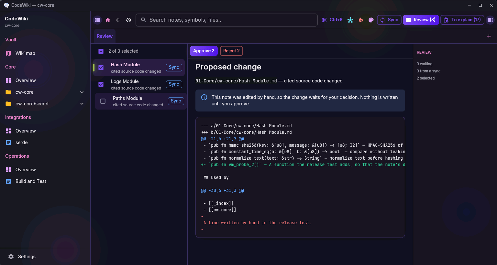

# Review

The Review page lists every change that waits for your decision, and shows the open one next to the list.

## Open it

* Press **Review (n)** in the toolbar. The number says how many proposals wait. The button is filled when some do.
* Or press Ctrl+K and choose **Review**.
* A notice **N new reviews in \<project>** has an **Open review** button that opens it too.

When nothing waits, the page says **Nothing waits for review.**

## What waits here

* A note you edited, and the code behind it changed. The text a sync would have written waits as a **Sync** proposal.
* A note you edited, and a coding agent explained it. The agent's text, with its pictures, waits as an **Agent** proposal.
* Notes you wrote yourself about code that is gone. They wait together in one **Retire** proposal.

See [Editing and proposals](editing-and-proposals.md) for why.

## Decide one proposal

Select a proposal in the list. The page shows the change as a diff: what would be removed and what would be added.

* **Approve and write** applies it to the note.
* **Reject** discards it. The same change is not proposed again.

After a decision, the next proposal opens. A notice says what happened, with an **Open note** button.

## Decide several at once



### Select the proposals

Click one. Hold Ctrl to add or remove single proposals. Hold Shift to select a range. Or tick the check boxes.



### Press the button

The buttons then read **Approve \<n>** and **Reject \<n>**, and act on the ticked rows. With none ticked, they act on the open proposal.



A proposal that cannot be decided, for example because it changed since it was proposed, does not stop the others. A notice lists what could not be done.


If you select a sync proposal and an agent proposal for the same note, the page warns you. Only one of them can be written. The other is superseded.


## Notes about code that is gone

The **Retire** proposal is named **Notes about code that is gone**. It lists each note above its text, with a check box.

* A ticked note is deleted.
* Untick a note to keep it as history.

The approve button says what it will do: **Delete 3 notes, keep 1**, for example. When you untick every note, it reads **Keep all as history**. Rejecting also keeps all of them as history.

A note you keep is not proposed again.

## From a terminal

`codewiki proposals`, `codewiki approve <id>` and `codewiki reject <id>` decide one proposal at a time. Deciding several at once is in the app only. A coding agent has no tool to decide a proposal. The decision stays with you.
