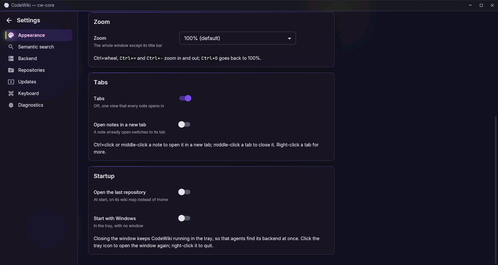
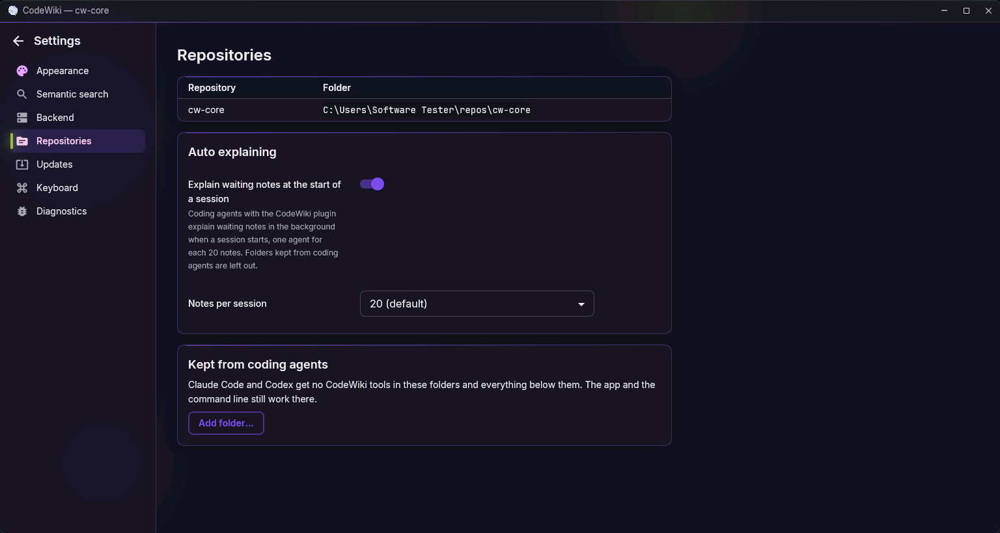

# Settings

Settings fills the window. It has a list of seven categories, a **Back** button, and a page for the category you choose.

## Open it

* Press Ctrl+, (Ctrl and a comma).
* Or press the **Settings** button at the foot of the sidebar or of Home.
* Or press Ctrl+K and choose **Open settings**, or **Settings: \<category>** to go straight to one.
* Or use **Settings** in the [tray menu](tray.md).

A change takes effect at once, unless the page says otherwise.

## Appearance

| Card        | Setting                                                                                                                                                                                                     |
| ----------- | ----------------------------------------------------------------------------------------------------------------------------------------------------------------------------------------------------------- |
| **Theme**   | **Theme** chooses one of the [themes](themes.md). **Background graph** shows or hides the notes and links that drift behind the glass, beside the page.                                                     |
| **Motion**  | **Animations**: **follow Windows**, **reduced** or **full**. By default the app follows the Windows setting Animation effects. With animations reduced, pages appear at once and the backdrop stands still. |
| **Zoom**    | How large the whole window is drawn, except its title bar: 50 to 200 percent, 100 by default. Ctrl+wheel, Ctrl+= and Ctrl+- zoom in and out, and Ctrl+0 goes back to 100 percent.                           |
| **Tabs**    | **Tabs** turns tabs on or off. **Open notes in a new tab** gives every note a tab of its own, and a note that is already open switches to its tab. It needs tabs on.                                        |
| **Startup** | **Open the last repository** starts the app on the wiki map instead of Home. **Start with Windows** starts CodeWiki in the tray with no window when you sign in. See below.                                 |

See [Reading notes](reading-notes.md#tabs) for what tabs can do.

### Start with Windows

It is off until you turn it on. It works only in an installed copy: in a copy built from source the switch is locked and says **Only an installed copy can start with Windows**. The app then starts in the tray. See [Tray and closing](tray.md).

## Semantic search

Choose the **Embedder**, its address and model, test it, and re-embed. See [Set up semantic search](../getting-started/semantic-search.md).

## Backend

The **Connection** card shows the address of the backend the app is connected to, and says how the app came to it:

* **It runs on this machine and stops when CodeWiki closes.** The app started it.
* **CODEWIKI\_URL names it. It is left running when CodeWiki closes.**
* **It is the backend saved below. It is left running when CodeWiki closes.**

The card **Backend on another machine** lets you use a backend in Docker or on another machine. Enter its **Address** and **Token** and press **Connect**. CodeWiki checks that it answers, and takes the token, before anything is saved. The app and an agent's MCP bridge on this machine then read the same wikis. The token is stored encrypted for your Windows user.

* **Use local backend** goes back to a backend on this machine. It keeps the address and token.
* **Forget** removes the saved backend.

If you set the environment variables `CODEWIKI_URL` and `CODEWIKI_TOKEN` before you start the app, they win over a saved address, and the fields are locked.

If the saved backend stops answering, the app says so and offers **Use local backend**. It never goes back to a backend on this machine by itself. See [Notifications and reconnecting](notifications.md).

A backend on another machine takes the search settings from its own environment variables. The Semantic search page then shows them, and you change them there.

## Repositories

The page lists the projects CodeWiki knows, with their folders. To remove one whose folder is gone, use **Remove** on [Home](home.md). Two cards follow.

### Auto explaining

**Explain waiting notes at the start of a session** lets coding agents with the CodeWiki plugin explain waiting notes in the background when a session starts. It is on by default. While it is on, **Notes per session** sets how many a session explains: 5, 10, 20 (the default), 50, 100 or **Unlimited**. Folders kept from coding agents are left out. See [Agent-written notes](../agents/writing-notes.md).

### Kept from coding agents

The folders where Claude Code and Codex get no CodeWiki tools. The app and the command line still work there. **Add folder…** adds one, and **Remove** takes one off. See [Folders kept from coding agents](../agents/keep-agents-out.md).

## Updates

**Version** shows your version and what the last check found. **Check now** asks GitHub at once, and becomes **Install and restart** when an update waits. **Daily check** turns the daily check on or off. A copy that is not an installation has no switch. See [Updating](../getting-started/updating.md).

## Keyboard

Lists the app's shortcuts. See [Command palette and shortcuts](command-palette-and-shortcuts.md#keyboard-shortcuts).

## Diagnostics

| Card              | Setting                                                         |
| ----------------- | --------------------------------------------------------------- |
| **Logs**          | **App log level**, and **Logs folder** with an **Open** button. |
| **Data**          | **Data folder** with an **Open** button.                        |
| **Error reports** | **Send error reports**. Off until you turn it on.               |

See [Logs and diagnostics](../reference/logs-and-diagnostics.md) and [Error reports and privacy](../reference/error-reports.md).

## Where settings are kept

Your choices are small text files in `%APPDATA%\CodeWiki`: the theme, the animation setting, the zoom, the project opened last, the recent projects and so on. Delete the folder to return to the defaults.

Settings that coding agents also use are in the data folder, `%LOCALAPPDATA%\CodeWiki`: the search settings, a saved backend, the switch for auto explaining and the list of folders kept from coding agents.
