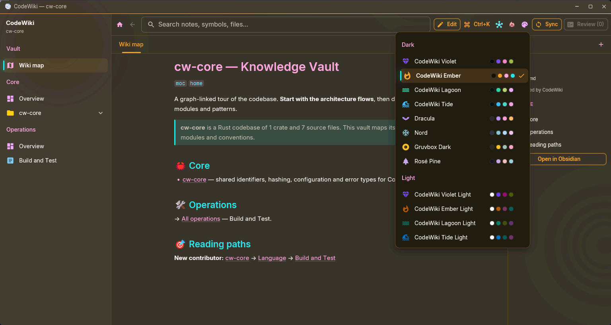

# Themes

CodeWiki comes with twelve themes: eight dark and four light.

## Choose a theme

Press the **Theme** button in the toolbar. A menu lists the themes under **Dark** and **Light**; each row shows a sample of the theme's colors, and a mark shows the one in use. Click a theme to apply it.

You can also choose it in Settings → Appearance → **Theme**.

By keyboard: press Ctrl+K, type `theme` and press Enter to open the menu, move with the arrow keys and press Enter. Or type `Theme:` and a theme's name into the palette and press Enter.

The app remembers your choice. The default is **CodeWiki Violet**.

## The bundled themes

| Dark            | Light                 |
| --------------- | --------------------- |
| CodeWiki Violet | CodeWiki Violet Light |
| CodeWiki Ember  | CodeWiki Ember Light  |
| CodeWiki Lagoon | CodeWiki Lagoon Light |
| CodeWiki Tide   | CodeWiki Tide Light   |
| Dracula         |                       |
| Nord            |                       |
| Gruvbox Dark    |                       |
| Rosé Pine       |                       |

Every theme is checked for contrast: text stays readable on each surface.

## Add your own

Put a theme file into the folder `themes` inside `%APPDATA%\CodeWiki`, in the same JSON format as the bundled ones, and start the app again. Your themes appear in the menu after the bundled ones.

CodeWiki adjusts the lightness of a theme's colors to its own levels, in the theme's own hues, so that text reads well on the app's glass surfaces. Syntax colors are left as you set them.

## The glass and the background graph

The window is translucent over a soft backdrop in the theme's colors. Beside the page, a sky of notes and links drifts in those colors. Light runs along the links, more often while a wiki is being written, and the nodes near the pointer brighten.

The backdrop stands still when the window is in the background, when animations are reduced, and on a machine without a graphics card. Settings → Appearance → **Background graph** turns the sky of notes off.

Settings → Appearance → **Animations** has three choices: **follow Windows**, **reduced** and **full**. By default the app follows the Windows setting Animation effects. With animations reduced, pages appear at once and the backdrop stands still.
