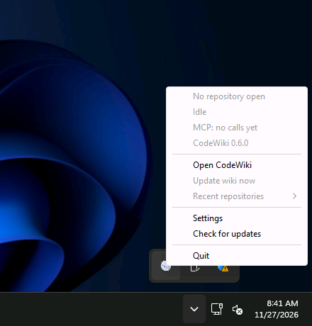

# Tray and closing

Closing the window does not end the app. CodeWiki stays in the notification area (the tray) with its backend, so a coding agent's first call finds a backend that is already running.

## Closing and quitting

* **Close the window** (the X, or Alt+F4) hides it. Nothing in it is lost: not the page, not unsaved edits.
* **Quit** ends the app and the local backend it uses. Choose **Quit** in the tray menu, or **Quit CodeWiki** in the command palette (Ctrl+K).

Quit is refused while a note has unsaved changes. Save or discard them first.

A backend that you named in `CODEWIKI_URL` or saved in Settings → Backend is left running. A coding agent's MCP bridge that shared the local backend starts a new one on its next call.

The first time you close the window, Windows shows a notification: **CodeWiki is still running. Click its icon in the notification area to open it again, right-click the icon to quit.**


Windows 11 puts a new icon behind the ^ arrow of the taskbar. Drag the icon onto the taskbar to keep it in view.


If Windows refuses a tray icon, closing the window ends the app.

## The tray icon

* **Click the icon** to open the window again, as you left it.
* **Right-click the icon** for the menu.
* **The tooltip** names the open repository, says what the app is doing, and says whether an agent's MCP bridge called lately.

### The menu

| Row                     | What it says or does                                                                                                      |
| ----------------------- | ------------------------------------------------------------------------------------------------------------------------- |
| The repository's name   | The open repository, or **No repository open**.                                                                           |
| What CodeWiki is doing  | For example **Idle**, **Updating wiki** or **Backend not running**.                                                       |
| **MCP: \<state>**       | **active**, **idle (last call \<time> ago)**, **no calls yet** or **unknown**. A call in the last five minutes is active. |
| The version             | **Update available: \<version>** opens the update, or shows your version when none waits.                                 |
| **Open CodeWiki**       | Shows the window.                                                                                                         |
| **Update wiki now**     | Syncs the open repository. Off when none is open, or while something else is running.                                     |
| **Recent repositories** | The projects you opened before, up to eight. Click one to open it.                                                        |
| **Settings**            | Opens [Settings](settings.md).                                                                                            |
| **Check for updates**   | Looks for a newer version.                                                                                                |
| **Quit**                | Ends the app.                                                                                                             |

The state shows a wiki update that you, an agent or a git webhook started.

## Start with Windows

Settings → Appearance → Startup → **Start with Windows** starts CodeWiki in the tray when you sign in, with no window. It is off until you turn it on. It needs an installed copy. The palette has **Start with Windows: turn on** and **turn off**.

Uninstalling CodeWiki removes the entry.

## Starting it a second time

Starting CodeWiki while it runs does not start a second app. The running app shows its window, on the folder you named if you named one, and the new launch ends. This holds for the Start menu and for `codewiki-app <folder>`.

The running app is the same program file. An installed copy and a copy built from source stay apart.
