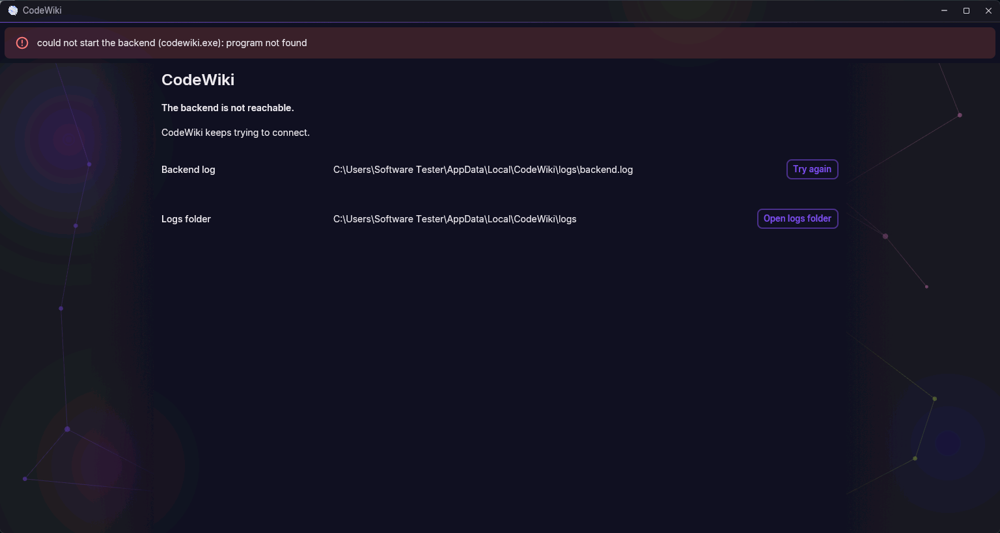

# Troubleshooting

## Read the logs first

CodeWiki writes its logs to `%LOCALAPPDATA%\CodeWiki\logs`: `app.log` for the app, `backend.log` for the backend and `mcp.log` for an agent's bridge. **Open logs folder** in the command palette, or Settings → Diagnostics, shows the folder. For more detail, choose a log level in Settings → Diagnostics. See [Logs and diagnostics](reference/logs-and-diagnostics.md).

## Windows says "Windows protected your PC"

SmartScreen warns about the setup program because the programs are not signed yet. Click **More info**, then **Run anyway**. See [Install](getting-started/install.md).

## The app says "The backend is not reachable"

The app gets everything from a backend program, `codewiki.exe`, which it starts itself. The page says **CodeWiki keeps trying to connect.** It names the backend's log and has a **Try again** button, and an **Open logs folder** button.



1. Press **Try again**.
2. If the page stays, open the log it names. The last lines say why the backend stopped.
3. Check that `codewiki.exe` is still in `%LOCALAPPDATA%\Programs\CodeWiki`. If an antivirus program removed it, restore it or install again.

If the page says that the backend at an address you chose in Settings does not answer, start that backend, or press **Use local backend**. The app never goes back to a local backend by itself. See [Notifications and reconnecting](the-app/notifications.md).

## A banner says "Backend not reachable, reconnecting…"

The backend stopped answering while you worked. The app tries again by itself, so you need not restart. When it succeeds, the banner goes and the notice **Reconnected** shows. To try at once, press Ctrl+K and choose **Reconnect to the backend**.

## `codewiki` is not recognized in a terminal

The installer adds the programs to your `PATH`, and a terminal that was already open does not see the change. Open a new terminal.

## Claude does not mention the wiki when a session starts

The plugin gives Claude a short briefing at the start of each session. To check it, run this in the repository:

```
codewiki hook session-start
```

* **It prints the briefing.** The command works. Check that the plugin is installed and enabled: `/plugin` in Claude Code lists it. In a session that was already open when you installed it, run `/reload-plugins`.
* **It prints nothing.** Either the folder is [kept from coding agents](agents/keep-agents-out.md), or the command hit an error. It stays quiet on purpose, so that it cannot break a session. Run `codewiki agents status` in the folder. If it is not kept, run `codewiki status` in the repository's top folder: it reads the same files and shows the error.
* **`codewiki` is not recognized.** Claude Code was started before CodeWiki was installed. Start it again from a new terminal.

See [The session-start briefing](agents/claude-code-plugin.md#the-session-start-briefing).

## Codex does not mention the wiki

Codex skips a plugin's hook until you trust it. Run `/hooks` in Codex and trust the `SessionStart` hook that runs `codewiki hook session-start --agent codex`. Do it again after an update changes the hook. See [Codex](agents/codex.md).

## Notes keep waiting for an explanation

**To explain (N)** stays high when no agent writes the notes. Check:

* **Auto explaining** is on in Settings → Repositories, and **Notes per session** is not too low.
* The session started fresh: startup, resume or `/clear`. It did not start in plan mode, in a linked git worktree or in a folder kept from coding agents.
* The plugin is installed. Without it, an agent has no tools to write notes.
* Claude Code asked you to allow a CodeWiki tool call. Allow `mcp__plugin_codewiki_codewiki__*` in your permission rules, so that the background agent can work.
* A run of `codewiki update` on the command line, or an edit in Obsidian, changes the count only after the next change or after you reopen the repository.

To write notes now, run `/codewiki:write-notes`. See [Agent-written notes](agents/writing-notes.md).

## A project shows under "Folder not found"

The project's folder is not where it was: it was moved, renamed or deleted, or its drive is not connected. The project stays on the list and opens again when the folder is back. If you no longer want it, press **Remove**. Nothing on disk is deleted. See [Home](the-app/home.md).

## A project is missing from Home

A linked git worktree has no row on Home. The row of its repository says how many worktrees it has. See [Home](the-app/home.md#git-worktrees).

## Home says a project has no wiki yet

Press **Sync** in the notice, or run `codewiki init` in the project's folder. See [Your first wiki](getting-started/your-first-wiki.md).

## My edit did not show up after an update

CodeWiki never overwrites a note you edited. When the code behind such a note changes, the new text waits as a proposal. Open **Review** in the toolbar and approve or reject it. See [Review](the-app/review.md).

## A note says "What it describes is gone from the repository"

The code the note describes was deleted. CodeWiki deletes such a note only after the deletion is committed, and only when git holds the note as it is, so that git can bring it back. Commit the deletion, or the note stays. A note you wrote yourself waits on the Review page. See [Editing and proposals](the-app/editing-and-proposals.md#when-the-code-is-gone).

## Search by meaning finds nothing new

Open Settings → Semantic search.

* **Embedder** is **Word forms: no model needed**, or **Off**. Choose a server.
* No **Model** is chosen. Search stays full-text alone until you choose one.
* The page shows a warning that the server is not running. Start it. The page asks again by itself.
* You changed the embedder or the model. Press **Sync now**. Search is full-text alone until the documents are embedded again.
* On a clean Windows, a server fails to start because the Microsoft Visual C++ Redistributable is missing. See [Set up semantic search](getting-started/semantic-search.md#on-a-clean-windows).

Press **Test** to see the server's own error.

## The window closes, but CodeWiki still runs

Closing the window hides it. CodeWiki stays in the tray. Click the tray icon to open the window, or choose **Quit** from the tray menu to end it. **Quit** is refused while a note has unsaved changes: the app says **Save or discard your edits first.** See [Tray and closing](the-app/tray.md).

## I do not see the tray icon

Windows 11 puts a new icon behind the ^ arrow of the taskbar. Drag it onto the taskbar to keep it in view.

## The update did not install

The app tells you what went wrong and leaves the installation as it was. Common causes:

* **No connection to GitHub.** Settings → Updates shows **could not check** and the reason. Check the connection and press **Check now**.
* **A program is still using a file.** Close other CodeWiki windows and try again.
* **The copy is not an installation.** A copy that was only unpacked, or built from source, does not update itself. Settings → Updates calls it a development build. Run the setup program, or `install.cmd` from the zip.

You can always update by hand: run the setup program, or unpack the new zip and run its `install.cmd`.

## The window is sluggish in a virtual machine or over remote desktop

Without a graphics card, Windows draws the app on the processor. CodeWiki notices this and keeps its moving backdrop still. If animations still feel slow, open Settings → Appearance and set **Animations** to **reduced**. You can also turn off **Background graph**.

## Start again from nothing

To remove the index, the logs and your settings, uninstall CodeWiki, answer **Yes** when it asks whether to delete your data and settings, then install again. For an installation from the zip, run `uninstall.cmd -PurgeData` from `%LOCALAPPDATA%\Programs\CodeWiki`. The wikis in your repositories stay as they are.

## Report a problem

Open an issue at [github.com/Fly-onlyone/CodeWiki/issues](https://github.com/Fly-onlyone/CodeWiki/issues). Say what you did, what you expected and what happened, and attach `app.log` and `backend.log`.


The logs name the folders of your projects. Read them before you post them in public.

