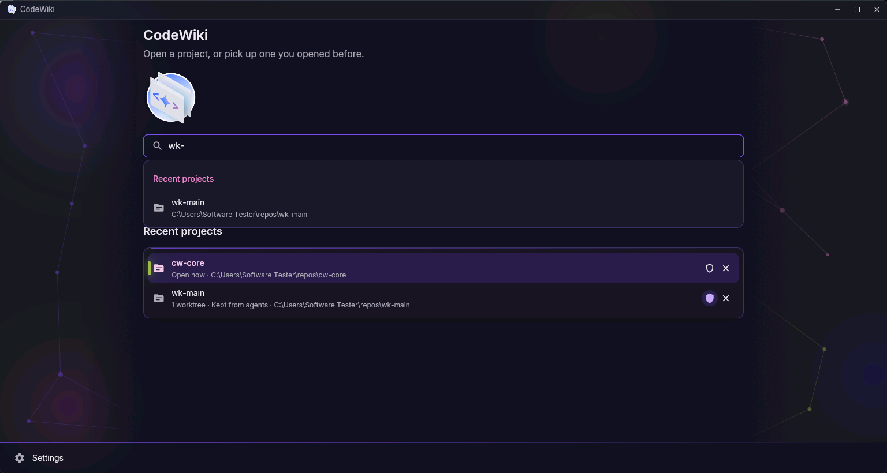

# Your first wiki

You need CodeWiki [installed](install.md) and a folder with source code. The folder does not have to be a git repository, but the reports that read history (hotspots, ownership) need git. Any language works: see [Languages](../reference/languages.md).

## In the app



### Open the project

Start CodeWiki. On Home, press **Open folder…** and choose the project's folder.





### Write the wiki

A project that has no wiki yet shows a notice on Home with a **Sync** button. Press it.

CodeWiki indexes the code and writes the notes into an `obsidian` folder inside the project. A bar at the top shows that it is working. A small project takes seconds; a large one can take minutes. A page **Sync complete** then says how many notes were written.



### Read it

When the sync ends, open the project from Home. You land on its **Wiki map**, the note that links to everything else. See [Reading notes](../the-app/reading-notes.md).



## From a terminal

```
cd C:\path\to\project
codewiki init
```

`init` does the same as the first **Sync**: it indexes the code and writes the wiki.

## What the first sync writes

CodeWiki writes the facts of every note from your code: where a thing is, what it contains, what it depends on and what uses it. It also copies what your comments say. It does not explain what a thing is for or how it works. Your coding agent writes that, through the plugin. Until then the notes wait, and the toolbar shows **To explain (N)**. See [Agent-written notes](../agents/writing-notes.md).

## Keep it current

After new commits, press **Sync** in the toolbar, or run:

```
codewiki update
```

Only the notes whose source changed are rewritten. A second update with no changes writes nothing.


A coding agent with the CodeWiki tools can do this too: its `sync_wiki` tool runs the same update.


## Commit the wiki

The `obsidian` folder is part of your repository. Commit it with your code, so that your team and your agents read the same wiki. Each update then shows in a diff what changed in the notes.

## What is in the wiki

| Folder            | Holds                                                                                       |
| ----------------- | ------------------------------------------------------------------------------------------- |
| `00-Architecture` | How the program starts and how its parts depend on each other, as flow notes with diagrams. |
| `01-Core`         | A note for each package and module, and for the types that matter most.                     |
| `03-Integrations` | The outside services and libraries the code talks to.                                       |
| `04-Patterns`     | Conventions the code follows.                                                               |
| `05-Operations`   | How to build, test and run the project.                                                     |
| `07-Decisions`    | Decision records. You create them.                                                          |

A small project has fewer folders: CodeWiki writes only what the code gives it something to say about.

The map note, `_HOME`, links to all of them. The app calls it **Wiki map**.
