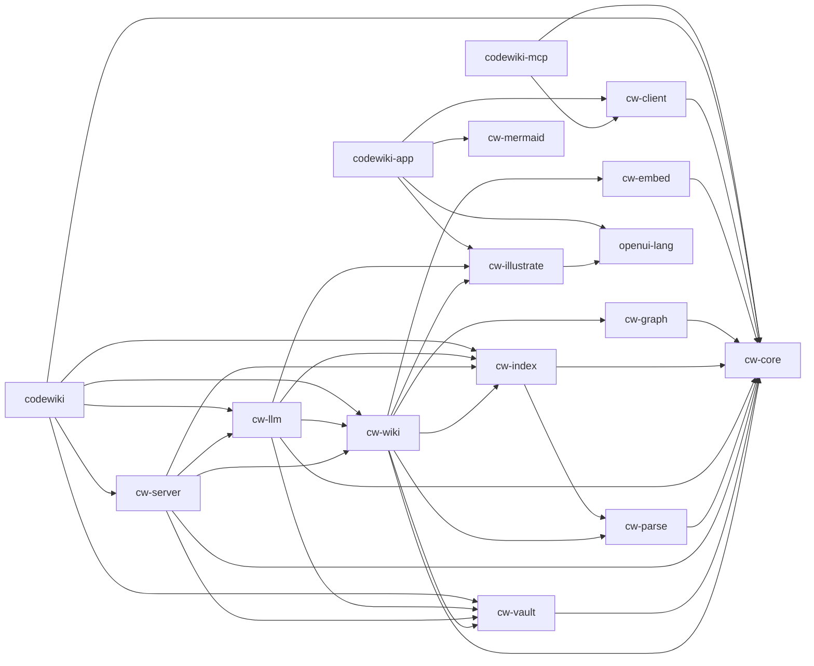

# Crate Dependency Flow

> How the 16 workspace crates depend on each other, from entry points down to shared foundations.

## Source

- `crates/codewiki-app/Cargo.toml` — declares dependencies
- `crates/codewiki-mcp/Cargo.toml` — declares dependencies
- `crates/codewiki/Cargo.toml` — declares dependencies
- `crates/cw-client/Cargo.toml` — declares dependencies
- `crates/cw-core/Cargo.toml` — declares dependencies
- `crates/cw-embed/Cargo.toml` — declares dependencies
- `crates/cw-graph/Cargo.toml` — declares dependencies
- `crates/cw-illustrate/Cargo.toml` — declares dependencies
- `crates/cw-index/Cargo.toml` — declares dependencies
- `crates/cw-llm/Cargo.toml` — declares dependencies
- `crates/cw-mermaid/Cargo.toml` — declares dependencies
- `crates/cw-parse/Cargo.toml` — declares dependencies
- `crates/cw-server/Cargo.toml` — declares dependencies
- `crates/cw-vault/Cargo.toml` — declares dependencies
- `crates/cw-wiki/Cargo.toml` — declares dependencies
- `crates/openui-lang/Cargo.toml` — declares dependencies

## How it works

An arrow points from a crate to a crate it depends on. Foundations with no workspace dependencies: `cw-core`, `cw-mermaid`, and `openui-lang`. Nothing in the workspace depends on `codewiki-app`, `codewiki-mcp`, and `codewiki`.

## Depends on

- [[codewiki-app]] — used by 0 workspace crates
- [[codewiki-mcp]] — used by 0 workspace crates
- [[codewiki]] — used by 0 workspace crates
- [[cw-client]] — used by 2 workspace crates
- [[cw-core]] — used by 11 workspace crates
- [[cw-embed]] — used by 1 workspace crates
- [[cw-graph]] — used by 1 workspace crates
- [[cw-illustrate]] — used by 3 workspace crates
- [[cw-index]] — used by 4 workspace crates
- [[cw-llm]] — used by 2 workspace crates
- [[cw-mermaid]] — used by 1 workspace crates
- [[cw-parse]] — used by 2 workspace crates
- [[cw-server]] — used by 1 workspace crates
- [[cw-vault]] — used by 4 workspace crates
- [[cw-wiki]] — used by 3 workspace crates
- [[openui-lang]] — used by 2 workspace crates

## See also

- [[_index]]
