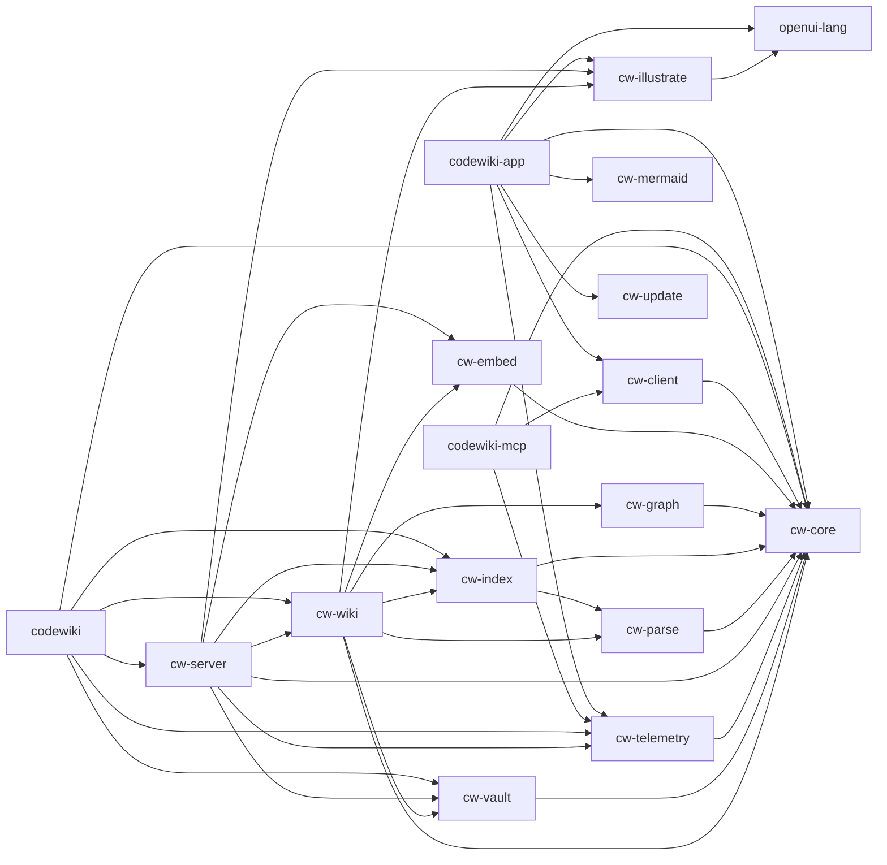

# Crate Dependency Flow

> How the 17 workspace crates depend on each other, from entry points down to shared foundations.

## Source

- `crates/codewiki-app/Cargo.toml` — declares dependencies
- `crates/codewiki-mcp/Cargo.toml` — declares dependencies
- `crates/codewiki/Cargo.toml` — declares dependencies
- `crates/cw-client/Cargo.toml` — declares dependencies
- `crates/cw-core/Cargo.toml` — declares dependencies
- `crates/cw-embed/Cargo.toml` — declares dependencies
- `crates/cw-graph/Cargo.toml` — declares dependencies
- `crates/cw-illustrate/Cargo.toml` — declares dependencies
- `crates/cw-index/Cargo.toml` — declares dependencies
- `crates/cw-mermaid/Cargo.toml` — declares dependencies
- `crates/cw-parse/Cargo.toml` — declares dependencies
- `crates/cw-server/Cargo.toml` — declares dependencies
- `crates/cw-telemetry/Cargo.toml` — declares dependencies
- `crates/cw-update/Cargo.toml` — declares dependencies
- `crates/cw-vault/Cargo.toml` — declares dependencies
- `crates/cw-wiki/Cargo.toml` — declares dependencies
- `crates/openui-lang/Cargo.toml` — declares dependencies

## How it works

The workspace has three layers.

The top layer holds the programs. [[codewiki]] is the command line and the backend server. [[codewiki-app]] is the Windows desktop app. [[codewiki-mcp]] is a stdio bridge between coding agents and the backend. Nothing depends on them.

The middle layer holds the engine. [[cw-server]] is the HTTP API of the backend and pulls together the wiki, vault, index, embedding, illustration and telemetry crates. [[cw-wiki]] is the generation pipeline. It uses [[cw-parse]] to read source, [[cw-index]] to keep the SQLite index, [[cw-vault]] for the note files, [[cw-graph]] for graphs, [[cw-embed]] for semantic search and [[cw-illustrate]] for note pictures.

The bottom layer is [[cw-core]]: shared identifiers, hashing, configuration and errors. Twelve crates use it. [[cw-mermaid]], [[cw-update]] and [[openui-lang]] have no workspace dependencies.

The app and the MCP bridge do not link the engine. Both reach the backend through [[cw-client]], which finds it, starts it if needed and makes the HTTP calls. So the app and the agents see the same backend. [[cw-telemetry]] is used by the programs and the server for opt-in error reports. The app also uses [[cw-update]] for self-update, [[cw-mermaid]] for diagrams and [[openui-lang]] for model-written UI, which [[cw-illustrate]] uses as well.

## Depends on

- [[codewiki-app]] — used by 0 workspace crates
- [[codewiki-mcp]] — used by 0 workspace crates
- [[codewiki]] — used by 0 workspace crates
- [[cw-client]] — used by 2 workspace crates
- [[cw-core]] — used by 12 workspace crates
- [[cw-embed]] — used by 2 workspace crates
- [[cw-graph]] — used by 1 workspace crates
- [[cw-illustrate]] — used by 3 workspace crates
- [[cw-index]] — used by 3 workspace crates
- [[cw-mermaid]] — used by 1 workspace crates
- [[cw-parse]] — used by 2 workspace crates
- [[cw-server]] — used by 1 workspace crates
- [[cw-telemetry]] — used by 4 workspace crates
- [[cw-update]] — used by 1 workspace crates
- [[cw-vault]] — used by 3 workspace crates
- [[cw-wiki]] — used by 2 workspace crates
- [[openui-lang]] — used by 2 workspace crates

## Gotchas

- Keep the arrows pointing down. The app must not depend on the engine crates. It goes through [[cw-client]] over HTTP.
- [[cw-core]] is the base of most crates. A change to it rebuilds nearly the whole workspace.
- [[openui-lang]] has no dependencies on purpose, and [[cw-illustrate]] builds on it. Do not add a UI dependency to it.

## See also

- [[_index]]
