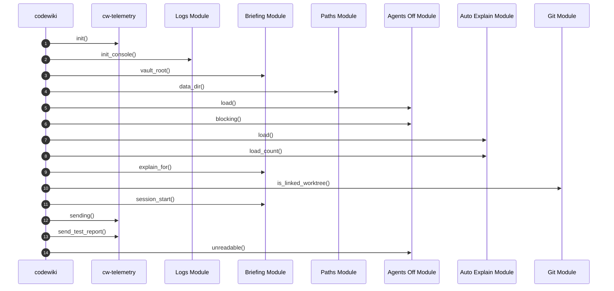

# codewiki Startup Flow

> Call sequence from the `main` entry point of `codewiki` across 8 parts of the codebase.

## Source

- `crates/codewiki/src/main.rs` — entry point

## How it works

`main` first parses the command line with clap. Then it picks one of four paths, in this order.

1. **The session-start hook.** `codewiki hook session-start` calls `session_start_hook` inside `catch_unwind`, with the panic hook silenced. It resolves the project folder (from `CLAUDE_PROJECT_DIR` when `--repo` is the default), finds the vault root with `vault_root`, and reads the list of folders kept from agents (`agents_off::load` and `blocking`). If the folder is blocked, or the list cannot be read, it prints nothing. Otherwise it asks `explain_for` whether this session should be ordered to explain notes, forces plain facts in a linked git worktree (`is_linked_worktree`), and prints the briefing from `session_start`. The exit status is always success.
2. **`sentry-test`.** Calls `cw_telemetry::init`, checks `sending()`, and sends one report with `send_test_report`, or panics on request.
3. **`agents`.** Edits or lists the folders kept from coding agents, using `file`, `unreadable` and the other `agents_off` functions.
4. **Everything else, through `run`.** Logging starts first: `serve` calls `cw_telemetry::init` (the only command that sends error reports), every other command calls `init_console` at warning level. `run` then resolves the repository root, loads the settings through `data_dir`, and dispatches to the matching `cw_wiki` function.

The diagram lists only calls that cross into another documented part. The long list of analysis commands such as `health` or `risk` is not in it, because those calls go to `cw-wiki` and `cw-server`, which have their own notes.

## Depends on

- [[codewiki]]
- [[cw-telemetry]]
- [[Logs Module]]
- [[Briefing Module]]
- [[Paths Module]]
- [[Agents Off Module]]
- [[Auto Explain Module]]
- [[Git Module]]

## Gotchas

- The hook must never disturb an agent session. A panic is caught and hidden, an argument error exits with success when the command line holds `hook`, and any failure prints nothing.
- `hook_input` reads stdin on a helper thread and waits at most one second. A host that keeps stdin open cannot hold up the session start. With auto explaining off, stdin is not read at all.
- A folder closed to coding agents gets no briefing. The same holds when the list file is unreadable: when in doubt, the hook says nothing.
- Only `serve` starts error reporting. Other commands log warnings and errors to the console and send nothing.
- `serve`, `sentry-test`, `agents` and `hook` are handled before the repository path is resolved, so they work outside a repository. The later `unreachable!` arms depend on that order.

## See also

- [[_index]]
- [[Crate Dependency Flow]]
