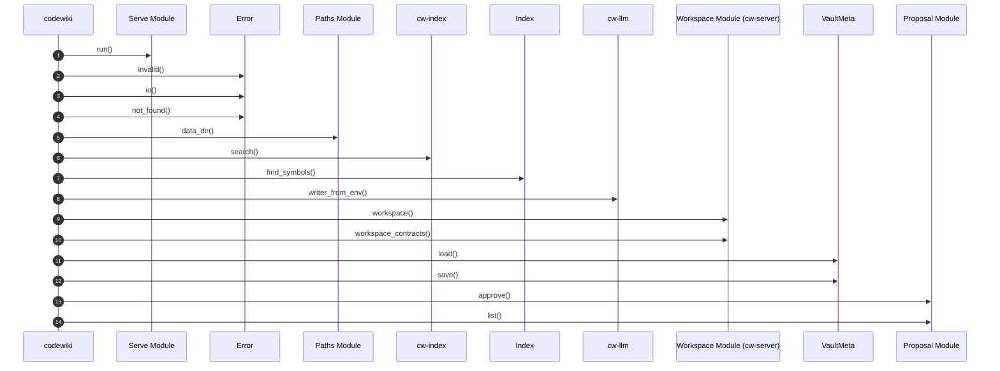

# codewiki Startup Flow

> Call sequence from the `main` entry point of `codewiki` across 10 parts of the codebase.

## Source

- `crates/codewiki/src/main.rs` — entry point

## How it works

The sequence follows resolved calls outward from `main`, keeping only calls that cross from one documented part into another. Calls reached through trait objects or macros do not appear.

## Depends on

- [[codewiki]]
- [[Serve Module]]
- [[Error]]
- [[Paths Module]]
- [[cw-index]]
- [[Index]]
- [[cw-llm]]
- [[Workspace Module (cw-server)]]
- [[VaultMeta]]
- [[Proposal Module]]

## See also

- [[_index]]
- [[Crate Dependency Flow]]
