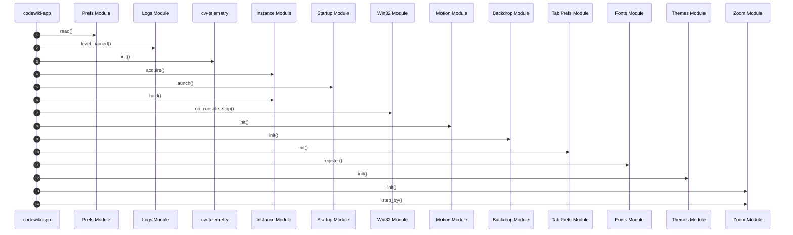

# codewiki-app Startup Flow

> Call sequence from the `main` entry point of `codewiki-app` across 13 parts of the codebase.

## Source

- `crates/codewiki-app/src/main.rs` — entry point

## How it works

`main` runs in two parts: setup before GPUI, then setup inside the GPUI run loop.

Before GPUI, it reads the log level from the settings through the [[Prefs Module]]. `CODEWIKI_LOG` can name another level for one run. Every record at Info and above goes to the log file, because a release build has no console. It then starts [[cw-telemetry]], which sends error reports only if the user turned them on.

Next it makes a channel for events that come from outside GPUI. It asks the [[Instance Module]] for the single-instance slot, passing the launch request from the [[Startup Module]]. If another copy of the app already runs, the request is handed over to it as an `Event::Handover` and `main` returns with no window. A primary copy holds the slot. A separate copy runs on its own. The [[Win32 Module]] then makes a console stop (Ctrl+C) send `Event::Quit`, so the app quits the way the tray does.

Inside the run loop, `gpui_kit::init` comes first, then the [[Motion Module]], the [[Backdrop Module]] and the [[Tab Prefs Module]], then the [[Fonts Module]] registers its fonts, then the [[Themes Module]] and finally the [[Zoom Module]]. The zoom actions and the key bindings (palette, tabs, back, save, sidebar, details, settings, zoom) are bound to the app. The window opens with the Mica backdrop. `AppView` is created inside a `backdrop::Shell`, which draws the backdrop, the app, and the generated page. Then three hooks are set: window close, Windows notification click, and app quit. All three only send events or ask the backend to stop; the work runs later in the view's `listen` task. On quit, the app frees the instance slot, flushes the telemetry queue, and asks the backend to stop. Last, the theme background of the window root is cleared so the backdrop shows.

## Depends on

- [[codewiki-app]]
- [[Prefs Module]]
- [[Logs Module]]
- [[cw-telemetry]]
- [[Instance Module]]
- [[Startup Module]]
- [[Win32 Module]]
- [[Motion Module]]
- [[Backdrop Module]]
- [[Tab Prefs Module]]
- [[Fonts Module]]
- [[Themes Module]]
- [[Zoom Module]]

## Gotchas

- Instance handover must run before anything of GPUI. A handed-over launch ends with no window.
- Fonts register before the themes, which name the font families. The Zoom Module comes after the themes, because it takes the theme's sizes as its 100% sizes.
- Closing the window only hides it when a tray icon exists. Quit from the tray ends the app. Without a tray icon, close ends the app, unless unsaved edits keep the window open.
- Hide and show are never done inside the close hook. GPUI is in the middle of a message there, so the hook sends `Event::Hide` and the view's task hides the window later.
- The zoom key actions are bound to the app, not to a view. A focused button in the generated page would not reach the view's handlers otherwise.
- GPUI paints the theme background over the whole window and would hide the backdrop. `main` clears it after the window opens. Remove that and the backdrop goes dark.
- On quit the app does not wait for the backend. It asks the backend to stop, and the backend finishes its current work and exits itself. A backend named by `CODEWIKI_URL`, or one an update has stopped, is not asked.
- GPUI may end the process before `main` drops the telemetry guard, so the quit hook flushes the reports itself.
- The diagram keeps only calls that cross between documented parts. Calls inside `main.rs` do not show.

## See also

- [[_index]]
- [[Crate Dependency Flow]]
