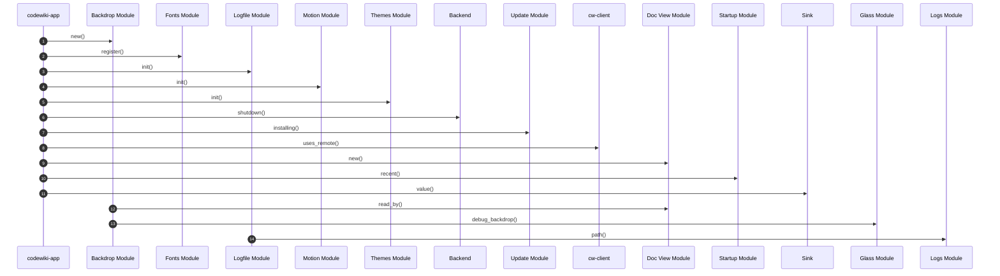

# codewiki-app Startup Flow

> Call sequence from the `main` entry point of `codewiki-app` across 14 parts of the codebase.

## Source

- `crates/codewiki-app/src/main.rs` — entry point

## How it works

The sequence follows resolved calls outward from `main`, keeping only calls that cross from one documented part into another. Calls reached through trait objects or macros do not appear.

## Depends on

- [[codewiki-app]]
- [[Backdrop Module]]
- [[Fonts Module]]
- [[Logfile Module]]
- [[Motion Module]]
- [[Themes Module]]
- [[Backend]]
- [[Update Module]]
- [[cw-client]]
- [[Doc View Module]]
- [[Startup Module]]
- [[Sink]]
- [[Glass Module]]
- [[Logs Module]]

## See also

- [[_index]]
- [[Crate Dependency Flow]]
