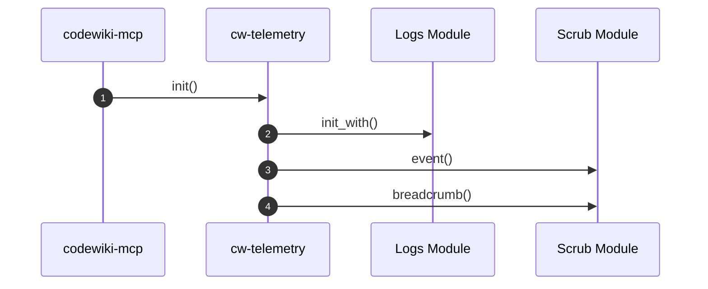

# codewiki-mcp Startup Flow

> Call sequence from the `main` entry point of `codewiki-mcp` across 4 parts of the codebase.

## Source

- `crates/codewiki-mcp/src/main.rs` — entry point

## How it works

The sequence follows resolved calls outward from `main`, keeping only calls that cross from one documented part into another. Calls reached through trait objects or macros do not appear.

## Depends on

- [[codewiki-mcp]]
- [[cw-telemetry]]
- [[Logs Module]]
- [[Scrub Module]]

## See also

- [[_index]]
- [[Crate Dependency Flow]]
