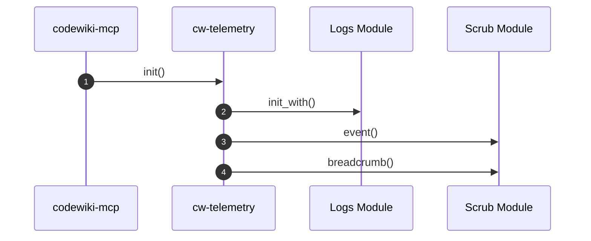

# codewiki-mcp Startup Flow

> Call sequence from the `main` entry point of `codewiki-mcp` across 4 parts of the codebase.

## Source

- `crates/codewiki-mcp/src/main.rs` — entry point

## How it works

`main` is async. It does two things before it serves anything.

First it calls `cw_telemetry::init` with the name `mcp` and the Info level. That sets up the log through the [[Logs Module]], with the log file and standard error as sinks. It also installs the [[Scrub Module]] hooks (`event` and `breadcrumb`), which strip paths and request data from error reports. Reports are sent only when the user turned them on.

Then it builds a `Bridge` and calls `serve` on the stdio transport. The bridge holds no backend yet. The backend connection is made on the first tool call, by `connected`, so listing the tools never starts a backend. `main` then waits until the agent closes the connection. A failed start or a failed wait logs an error and returns a failure exit code. A clean close returns success.

Once serving, each tool call goes through `call_tool`. It first runs `screen`, which refuses calls for folders the user kept from coding agents. Only then does the router run the tool. The diagram shows startup only, so this per-call path is not in it.

## Depends on

- [[codewiki-mcp]]
- [[cw-telemetry]]
- [[Logs Module]]
- [[Scrub Module]]

## Gotchas

- Standard output carries the MCP protocol. Nothing else may be printed there. Logs go to the log file and to standard error.
- The bridge connects to the backend lazily. A failed start is not kept, so the next tool call tries again. A kept backend that no longer answers is dropped and a new one is found. This matters because the app stops the backend when it installs an update.
- The refusal check runs before the router, so a closed folder starts no backend.

## See also

- [[_index]]
- [[Crate Dependency Flow]]
